# Revisión de la batería de C2_AGE

Generado por `opox`; no editar. Las decisiones se toman en `bank_merges.csv` y
`bank_contexts.csv`. En negrita, lo que difiere entre ambas versiones.

## Fusiones pendientes (55)

### 2019E0A-1-6 ↔ 2019L0A-1-7 (text)

**2019E0A-1-6** (2019E0A-1-6)

Según la Ley Orgánica 6/1985, de 1 de julio, del Poder **judicial,** el Consejo General del Poder Judicial se renovará en su totalidad:

- Respuesta: Cada 5 años, contados desde la fecha de su constitución.
- Cada 8 años, contados desde la fecha de su constitución.
- Cada 6 años, contados desde la fecha de su constitución.
- Cada 4 años, contados desde la fecha de su constitución.

_(sin contexto)_

**2019L0A-1-7** (2019L0A-1-7)

Según la Ley Orgánica 6/1985, de 1 de julio, del Poder **judicial (en adelante LOPJ),** el Consejo General del Poder Judicial se renovará en su totalidad:

- Respuesta: Cada 5 años, contados desde la fecha de su constitución.
- Cada 8 años, contados desde la fecha de su constitución.
- Cada 6 años, contados desde la fecha de su constitución
- Cada 4 años, contados desde la fecha de su constitución.

_(sin contexto)_

### 2019E0X-1-15 ↔ 2019L0X-1-19 (text)

**2019E0X-1-15** (2019E0X-1-15)

De acuerdo el Capítulo I del Real Decreto Legislativo 5/2015, de 30 de octubre, por el que se aprueba el Texto Refundido del Estatuto Básico del Empleado Público (en adelante TREBEP), el funcionario de carrera es:

- Respuesta: Quien, en virtud de nombramiento legal, está vinculado a una Administración Pública por una relación estatutaria regulada por el Derecho Administrativo para el desempeño de servicios profesionales retribuidos de carácter permanente.
- Quien, en virtud de contrato de trabajo formalizado por escrito presta servicios retribuidos para las Administraciones Públicas.
- Quien, en virtud de nombramiento legal, está vinculado a una Administración Pública por una relación laboral para el desempeño de servicios profesionales retribuidos de carácter permanente.
- Quien desarrolla funciones directivas profesionales en las Administraciones Públicas, definidas como tales en las normas específicas de cada Administración.

_(sin contexto)_

**2019L0X-1-19** (2019L0X-1-19)

De acuerdo **con** el Capítulo I del Real Decreto Legislativo 5/2015, de 30 de octubre, por el que se aprueba el Texto Refundido del Estatuto Básico del Empleado Público (en adelante TREBEP), el funcionario de carrera es:

- Respuesta: Quien, en virtud de nombramiento legal, está vinculado a una Administración Pública por una relación estatutaria regulada por el Derecho Administrativo para el desempeño de servicios profesionales retribuidos de carácter permanente.
- Quien, en virtud de contrato de trabajo formalizado por escrito presta servicios retribuidos para las Administraciones Públicas.
- Quien, en virtud de nombramiento legal, está vinculado a una Administración Pública por una relación laboral para el desempeño de servicios profesionales retribuidos de carácter permanente.
- Quien desarrolla funciones directivas profesionales en las Administraciones Públicas, definidas como tales en las normas específicas de cada Administración.

_(sin contexto)_

### 2019E0X-2-25 ↔ 2019I0X-1-34 (context)

**2019E0X-2-25** (2019E0X-2-25)

En un nuevo correo electrónico de Outlook 2019, ¿cuál es la utilidad de la opción Formato de texto > Edición > Buscar?

- Respuesta: Buscar texto en el correo electrónico que estamos editando.
- Buscar contactos de Outlook para incluirlos como destinatarios del correo.
- Buscar otros mensajes relacionados por el destinatario del correo.
- Buscar en el Asistente para programación tiempo libre del destinatario para una reunión.

_(sin contexto)_

**2019I0X-1-34** (2019I0X-1-34)

En un nuevo correo electrónico de Outlook 2019, ¿cuál es la utilidad de la opción Formato de texto > Edición > Buscar?

- Respuesta: Buscar texto en el correo electrónico que estamos editando.
- Buscar contactos de Outlook para incluirlos como destinatarios del correo.
- Buscar otros mensajes relacionados por el destinatario del correo.
- Buscar en el Asistente para programación tiempo libre del destinatario para una reunión.

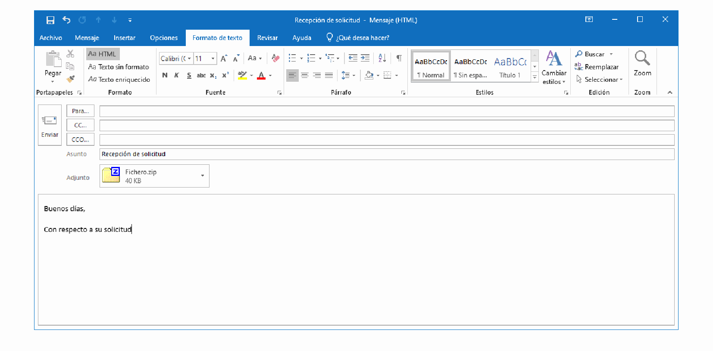

### 2019I0A-1-10 ↔ 2019L0A-2-13 (options)

**2019I0A-1-10** (2019I0A-1-10)

¿Cuál es la función de Windows Update en Windows 10?

- Respuesta: Administrar la configuración de las actualizaciones de Windows 10.
- Mantener la fecha y la hora de Windows actualizadas.
- **Crear eventos, como citas o notificaciones, en el Calendario de Windows.**
- Adquirir a través de Microsoft Store actualizaciones de productos Microsoft.

_(sin contexto)_

**2019L0A-2-13** (2019L0A-2-13)

¿Cuál es la función de Windows Update en Windows 10?

- Respuesta: Administrar la configuración de las actualizaciones de Windows 10.
- Mantener la fecha y la hora de Windows actualizadas.
- **Crear eventos, como citas, en el Calendario de Windows.**
- Adquirir a través de Microsoft Store actualizaciones de productos Microsoft.

_(sin contexto)_

### 2019I0A-1-19 ↔ 2019L0A-2R-3 (text)

**2019I0A-1-19** (2019I0A-1-19)

La opción "Columnas" de Word permite seleccionar el número de columnas en que dispondremos el texto. ¿En cuál de las siguientes pestañas de la cinta de opciones de Word se encuentra **dicha opción** de forma predeterminada?

- Respuesta: Disposición.
- Insertar.
- Vista.
- Correspondencia.

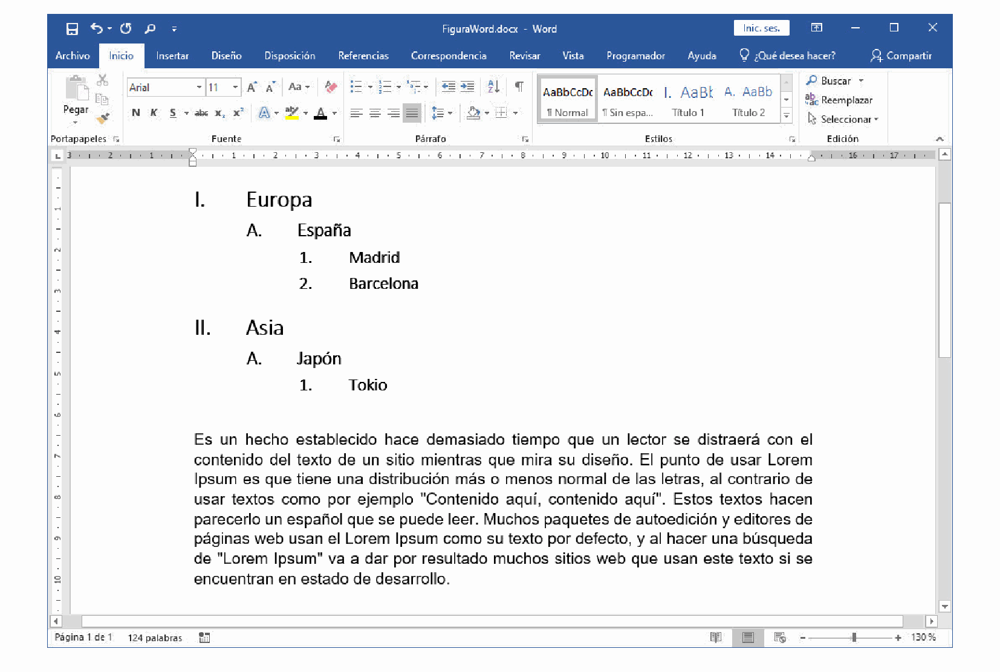

**2019L0A-2R-3** (2019E0A-2-5, 2019L0A-2R-3)

La opción "Columnas" de Word permite seleccionar el número de columnas en que dispondremos el texto. ¿En cuál de las siguientes pestañas de la cinta de opciones de Word se encuentra de forma predeterminada?

- Respuesta: Disposición.
- Insertar.
- Vista.
- Correspondencia.

_(sin contexto)_

### 2019I0A-1-22 ↔ 2019L0A-2-29 (text)

**2019I0A-1-22** (2019I0A-1-22)

En **la** hoja Excel **mostrada** seleccionamos **las** celdas **B2, B3 y B4 (con** los valores 5, 10 y **15).** Arrastramos **hacia abajo** el controlador de relleno (esquina inferior derecha de la selección) a las dos celdas inferiores que están vacías. ¿Qué obtendremos en esas dos celdas inferiores?

- Respuesta: El valor 20 en la primera celda y 25 en la segunda.
- La suma (30) en la celda inmediatamente inferior. La siguiente celda quedará en blanco.
- Las celdas quedan vacías, tal y como estaban.
- En las dos celdas inferiores se mostrará la suma (30) de los valores seleccionados.

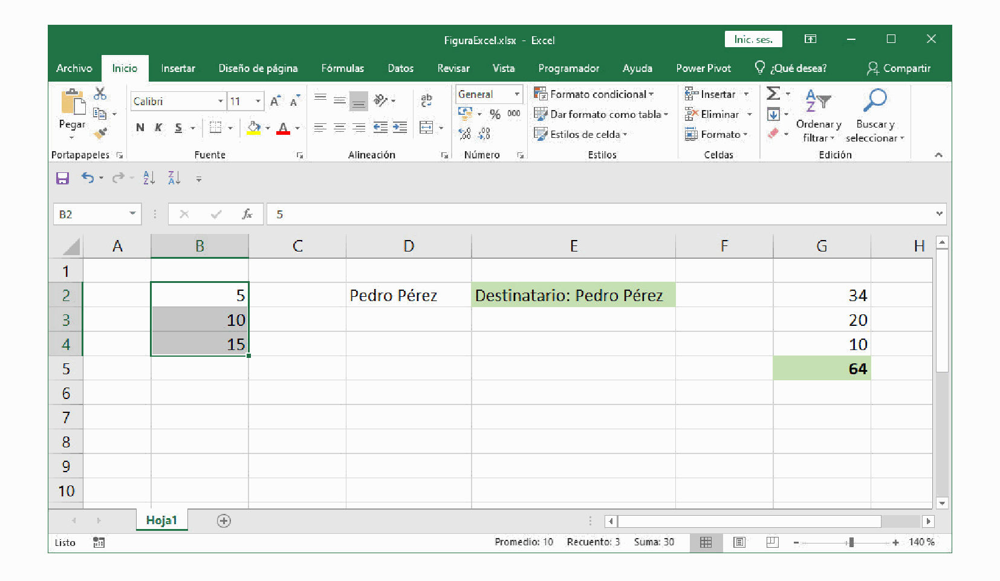

**2019L0A-2-29** (2019E0A-2-13, 2019L0A-2-29)

En **una** hoja Excel seleccionamos **tres** celdas **de una columna con** los valores 5, 10 y **15.** Arrastramos el controlador de relleno (esquina inferior derecha de la selección) a las dos celdas inferiores que están vacías. ¿Qué obtendremos en esas dos celdas inferiores?

- Respuesta: El valor 20 en la primera celda y 25 en la segunda.
- La suma (30) en la celda inmediatamente inferior. La siguiente celda quedará en blanco.
- Las celdas quedan vacías, tal y como estaban.
- En las dos celdas inferiores se mostrará la suma (30) de los valores seleccionados.

_(sin contexto)_

### 2019I0A-1-30 ↔ 2019L0A-2-32 (context)

**2019I0A-1-30** (2019I0A-1-30)

Estamos en la Vista preliminar de un informe de Access y queremos exportarlo. ¿Cuál de los siguientes formatos de exportación NO está disponible?

- Respuesta: Visio.
- Excel.
- PDF.
- Word.

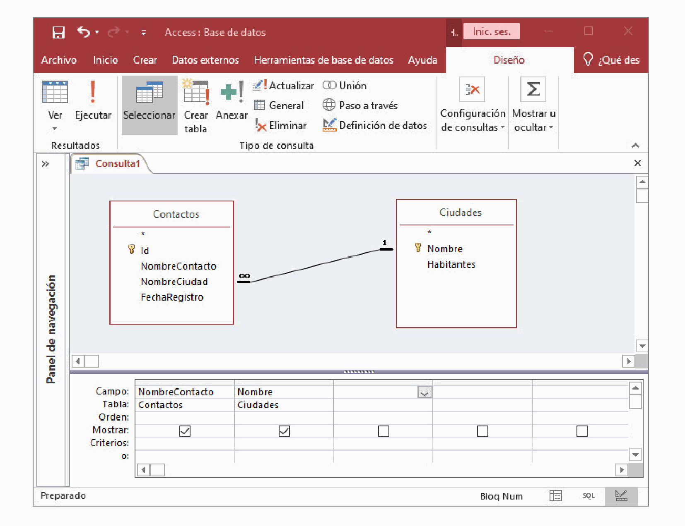

**2019L0A-2-32** (2019E0A-2-16, 2019L0A-2-32)

Estamos en la Vista preliminar de un informe de Access y queremos exportarlo. ¿Cuál de los siguientes formatos de exportación NO está disponible?

- Respuesta: Visio.
- Excel.
- PDF.
- Word.

_(sin contexto)_

### 2019I0A-1-35 ↔ 2019L0A-2-42 (context)

**2019I0A-1-35** (2019I0A-1-35)

¿Cuál es la utilidad de la acción "Combinar correspondencia" en la pestaña Inicio de los contactos de Outlook?

- Respuesta: Crear un correo electrónico o carta modelo para enviarlo a un conjunto de contactos. Cada contacto recibirá un correo electrónico o carta modelo individual.
- En el caso de tener más de una cuenta agregada a Outlook, redirigir todos los mensajes y citas de las distintas cuentas a la cuenta principal.
- Permitir la fusión de varios correos electrónicos recibidos para ahorrar espacio en el disco duro.
- Crear una carpeta donde almacenar correos recibidos en diferentes cuentas configuradas en Outlook.

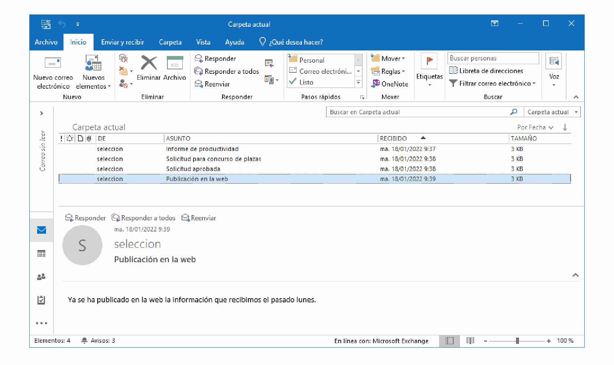

**2019L0A-2-42** (2019E0A-2-23, 2019L0A-2-42)

¿Cuál es la utilidad de la acción "Combinar correspondencia" en la pestaña Inicio de los contactos de Outlook?

- Respuesta: Crear un correo electrónico o carta modelo para enviarlo a un conjunto de contactos. Cada contacto recibirá un correo electrónico o carta modelo individual.
- En el caso de tener más de una cuenta agregada a Outlook, redirigir todos los mensajes y citas de las distintas cuentas a la cuenta principal.
- Permitir la fusión de varios correos electrónicos recibidos para ahorrar espacio en el disco duro.
- Crear una carpeta donde almacenar correos recibidos en diferentes cuentas configuradas en Outlook.

_(sin contexto)_

### 2019I0A-1-37 ↔ 2019L0A-2-48 (options)

**2019I0A-1-37** (2019I0A-1-37)

¿Cuál es la definición del término "Cookie", utilizado por los navegadores web?

- Respuesta: Pequeña información enviada por un sitio web y almacenada en el navegador del usuario, de manera que el sitio web puede consultar la actividad previa del navegador.
- Pequeño programa ejecutable cargado en el sistema, sin conocimiento del usuario, a través del correo electrónico.
- Pequeño terminal informático que se puede trasladar fácilmente de una ubicación física a otra y se utiliza para proteger la información almacenada.
- **Transacción monetaria entre empresas que resulta de los servicios o productos ofrecidos a través del comercio electrónico.**

_(sin contexto)_

**2019L0A-2-48** (2019E0A-2-29, 2019L0A-2-48)

¿Cuál es la definición del término "Cookie", utilizado por los navegadores web?

- Respuesta: Pequeña información enviada por un sitio web y almacenada en el navegador del usuario, de manera que el sitio web puede consultar la actividad previa del navegador.
- Pequeño programa ejecutable cargado en el sistema, sin conocimiento del usuario, a través del correo electrónico.
- Pequeño terminal informático que se puede trasladar fácilmente de una ubicación física a otra y se utiliza para proteger la información almacenada.
- **Formas diferentes de la venta directa de convertir en dinero los servicios o productos ofrecidos a través del comercio electrónico.**

_(sin contexto)_

### 2019I0A-1R-1 ↔ 2019L0A-2-9 (options)

**2019I0A-1R-1** (2019I0A-1R-1)

¿A cuál de las siguientes definiciones corresponden las siglas OCR?

- Respuesta: Reconocimiento óptico de caracteres.
- **Opción de consulta recurrente.**
- **Recurso compartido por la organización.**
- Terminal de red óptica.

_(sin contexto)_

**2019L0A-2-9** (2019L0A-2-9)

¿A cuál de las siguientes definiciones corresponden las siglas OCR?

- Respuesta: Reconocimiento óptico de caracteres.
- **Biblioteca abierta de gráficos.**
- **Lenguaje de computación abierto.**
- Terminal de red óptica.

_(sin contexto)_

### 2019I0X-1-14 ↔ 2019L0X-2-31 (options)

**2019I0X-1-14** (2019I0X-1-14)

Entre los accesorios de Windows 10 hay dos editores de texto: Bloc de notas y WordPad. ¿Cuál de las siguientes características sólo está disponible en WordPad?

- Respuesta: Permite insertar imágenes en un documento.
- **Permite imprimir el documento.**
- Permite incluir un pie de página.
- Permite abrir ficheros de texto con extensión .txt

_(sin contexto)_

**2019L0X-2-31** (2019L0X-2-31)

Entre los accesorios de Windows 10 hay dos editores de texto: Bloc de notas y WordPad. ¿Cuál de las siguientes características sólo está disponible en WordPad?

- Respuesta: Permite insertar imágenes en un documento.
- **Permite cambiar el tipo y tamaño de la fuente.**
- Permite incluir un pie de página.
- Permite abrir ficheros de texto con extensión .txt

_(sin contexto)_

### 2019I0X-1-18 ↔ 2019L0X-2-37 (context)

**2019I0X-1-18** (2019I0X-1-18)

Queremos insertar en un documento Word una ilustración que muestre un gráfico de superficie y poder editar los datos que alimentan el gráfico. ¿Cuál de los siguientes tipos de ilustración de la pestaña Insertar deberemos utilizar?

- Respuesta: Gráfico.
- Formas.
- SmartArt.
- Iconos.

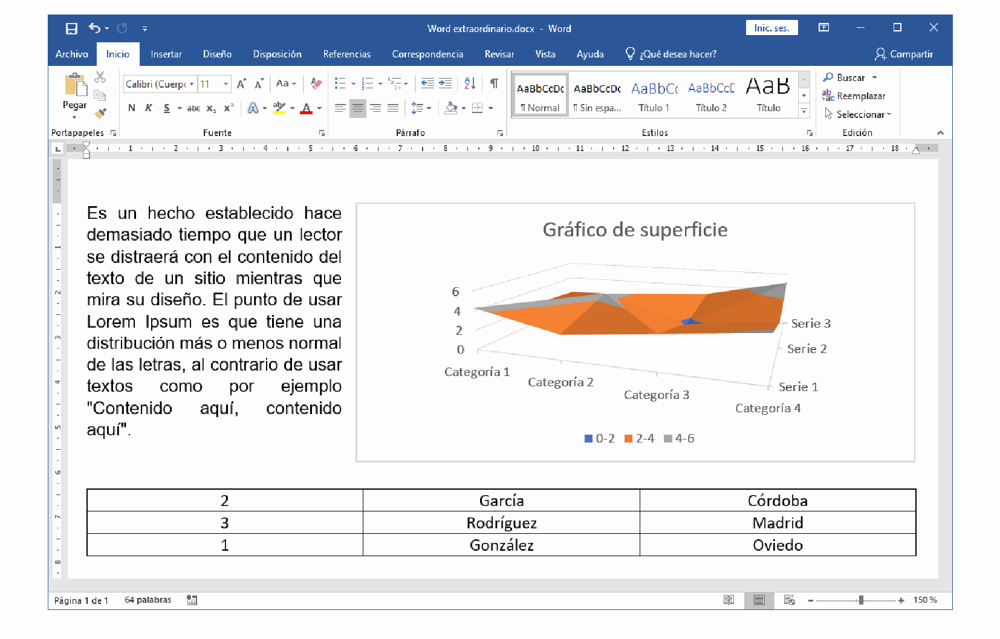

**2019L0X-2-37** (2019E0X-2-8, 2019L0X-2-37)

Queremos insertar en un documento Word una ilustración que muestre un gráfico de superficie y poder editar los datos que alimentan el gráfico. ¿Cuál de los siguientes tipos de ilustración de la pestaña Insertar deberemos utilizar?

- Respuesta: Gráfico.
- Formas.
- SmartArt.
- Iconos.

_(sin contexto)_

### 2019I0X-1-19 ↔ 2019L0X-2-34 (context)

**2019I0X-1-19** (2019I0X-1-19)

¿Cuál de las siguientes opciones es correcta con respecto a ordenar los datos de una tabla de Word?

- Respuesta: Es posible, situando el cursor dentro de la tabla, y pulsando el botón Ordenar de la pestaña Inicio de la cinta de opciones de Word.
- Es posible, haciendo clic con el botón secundario del ratón sobre la tabla, y en el menú desplegable, Propiedades > Ordenar.
- No es posible si la tabla está hecha en Word. Si está hecha en Excel, podemos ordenarla antes de incrustarla en el texto.
- Es posible, seleccionando la columna y haciendo clic con el botón secundario del ratón, y en el menú desplegable, Ordenar.

**2019L0X-2-34** (2019E0X-2-3, 2019L0X-2-34)

¿Cuál de las siguientes opciones es correcta con respecto a ordenar los datos de una tabla de Word?

- Respuesta: Es posible, situando el cursor dentro de la tabla, y pulsando el botón Ordenar de la pestaña Inicio de la cinta de opciones de Word.
- Es posible, haciendo clic con el botón secundario del ratón sobre la tabla, y en el menú desplegable, Propiedades > Ordenar.
- No es posible si la tabla está hecha en Word. Si está hecha en Excel, podemos ordenarla antes de incrustarla en el texto.
- Es posible, seleccionando la columna y haciendo clic con el botón secundario del ratón, y en el menú desplegable, Ordenar.

_(sin contexto)_

### 2019I0X-1-25 ↔ 2019L0X-2R-4 (context)

**2019I0X-1-25** (2019I0X-1-25)

En Excel, dentro de la pestaña "Diseño de página" de la cinta de opciones, ¿cuál es la utilidad de la opción Fondo?

- Respuesta: Permite elegir una imagen para el fondo de la hoja.
- Configurar las propiedades del fondo de la hoja, como color o visualización de la rejilla.
- Establecer el área de impresión de la hoja.
- Establecer el tamaño de página.

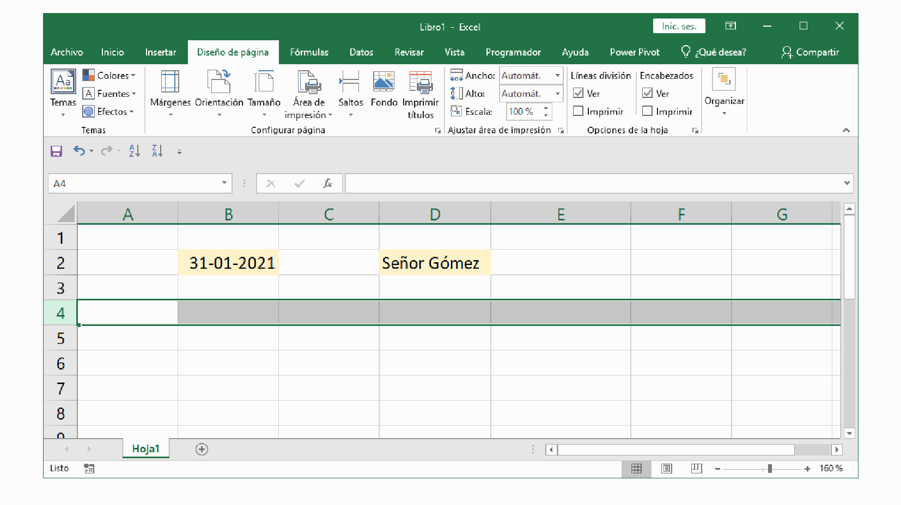

**2019L0X-2R-4** (2019E0X-2-12, 2019L0X-2R-4)

En Excel, dentro de la pestaña "Diseño de página" de la cinta de opciones, ¿cuál es la utilidad de la opción Fondo?

- Respuesta: Permite elegir una imagen para el fondo de la hoja.
- Configurar las propiedades del fondo de la hoja, como color o visualización de la rejilla.
- Establecer el área de impresión de la hoja.
- Establecer el tamaño de página.

_(sin contexto)_

### 2019I0X-1-26 ↔ 2019L0X-2-44 (context)

**2019I0X-1-26** (2019I0X-1-26)

¿Cuál de los siguientes es el significado correcto para el carácter # en la definición de una máscara de entrada en un campo de una tabla Access?

- Respuesta: El usuario puede escribir un dígito, espacio, signo más o signo menos. Si se omite, Access escribe un espacio en blanco.
- El usuario solamente puede introducir una letra.
- El usuario solamente puede introducir un dígito (0 a 9).
- El usuario solamente puede introducir una letra minúscula o un espacio.

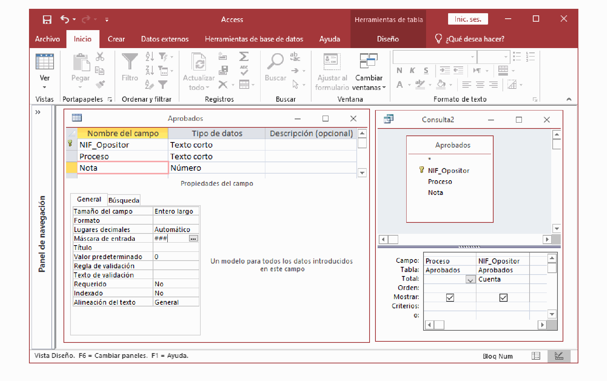

**2019L0X-2-44** (2019E0X-2-20, 2019L0X-2-44)

¿Cuál de los siguientes es el significado correcto para el carácter # en la definición de una máscara de entrada en un campo de una tabla Access?

- Respuesta: El usuario puede escribir un dígito, espacio, signo más o signo menos. Si se omite, Access escribe un espacio en blanco.
- El usuario solamente puede introducir una letra.
- El usuario solamente puede introducir un dígito (0 a 9).
- El usuario solamente puede introducir una letra minúscula o un espacio.

_(sin contexto)_

### 2019L0A-2-31 ↔ 2022E0A-1-56 (text)

**2019L0A-2-31** (2019L0A-2-31)

Al diseñar una tabla de **Access,** en el campo FechaAlta incluimos la siguiente Regla de validación **(sin las comillas): ">=Fecha()".** ¿Qué efecto tendrá la regla?

- Respuesta: Impide introducir valores de fechas anteriores al día actual.
- Recoge el valor de la tabla Fecha.
- **Introduce un valor de fecha por defecto.**
- Impide introducir valores de fechas futuras.

_(sin contexto)_

**2022E0A-1-56** (2022E0A-1-56)

Al diseñar una tabla de **Access 2019,** en el campo FechaAlta incluimos la siguiente Regla de validación **>=Fecha()** ¿Qué efecto tendrá la regla?

- Respuesta: Impide introducir valores de fechas anteriores al día actual.
- Recoge el valor de la tabla Fecha.
- **Visualiza la fecha actual en el encabezado de un informe.**
- Impide introducir valores de fechas futuras.

_(sin contexto)_

### 2019L0A-2-37 ↔ 2025I0A-1-31 (text)

**2019L0A-2-37** (2019L0A-2-37)

¿Cuál es la longitud máxima de un campo de tipo **"Texto corto" en Access 2019?**

- Respuesta: 255 caracteres.
- 16 caracteres.
- **125 caracteres.**
- **8 caracteres.**

_(sin contexto)_

**2025I0A-1-31** (2025I0A-1-31)

¿Cuál es la longitud máxima de un campo de tipo **Texto corto?**

- Respuesta: 255 caracteres.
- 16 caracteres.
- **No tiene límite de longitud.**
- **64 caracteres.**

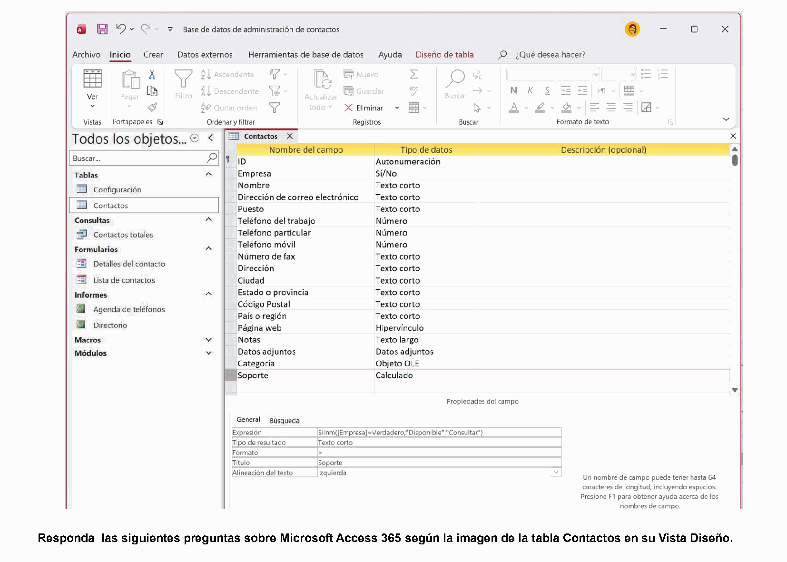

### 2019L0A-2-37 ↔ 2025I0B-1-31 (text)

**2019L0A-2-37** (2019L0A-2-37)

¿Cuál es la longitud máxima de un campo de tipo **"Texto corto" en Access 2019?**

- Respuesta: 255 caracteres.
- 16 caracteres.
- **125 caracteres.**
- **8 caracteres.**

_(sin contexto)_

**2025I0B-1-31** (2025I0B-1-31)

¿Cuál es la longitud máxima de un campo de tipo **Texto corto?**

- Respuesta: 255 caracteres.
- 16 caracteres.
- **No tiene límite de longitud.**
- **64 caracteres.**

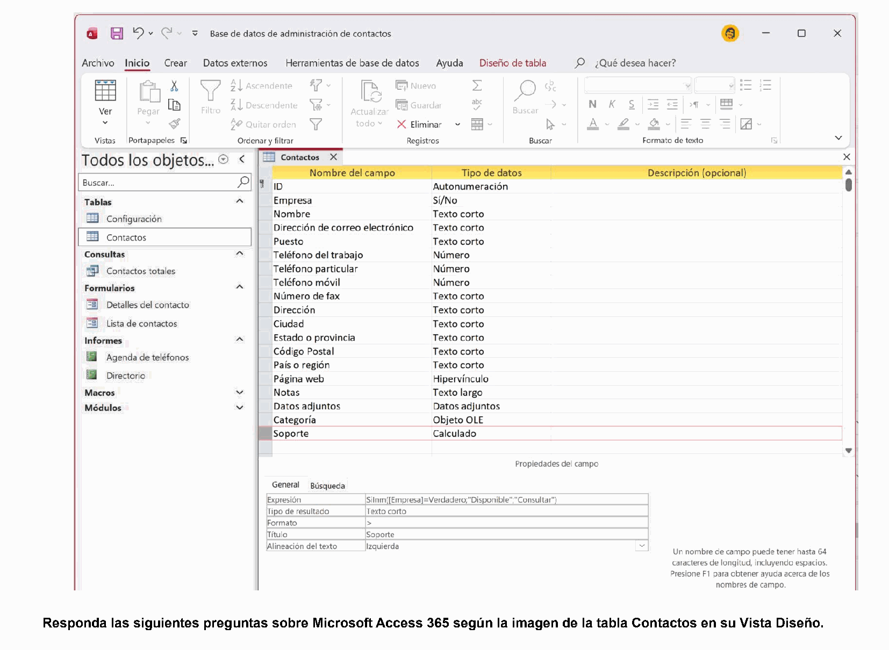

### 2019L0X-1-38 ↔ 2024L0B-1R-3 (text)

**2019L0X-1-38** (2019L0X-1-38)

**Indique,** entre las siguientes **palabras,** cuál es el antónimo de la palabra **PROSPERIDAD:**

- Respuesta: Desdicha.
- **Aventura.**
- **Importancia.**
- **Caracola.**

_(sin contexto)_

**2024L0B-1R-3** (2024L0A-1R-3, 2024L0B-1R-3)

**Indique** entre las siguientes **palabras** cuál es el antónimo de la palabra **VENTURA.**

- Respuesta: Desdicha.
- **Aireado.**
- **Quimerista.**
- **Peligroso.**

_(sin contexto)_

### 2019L0X-1-38 ↔ 2025L0B-1-34 (text)

**2019L0X-1-38** (2019L0X-1-38)

**Indique,** entre las siguientes **palabras,** cuál es el antónimo de la palabra **PROSPERIDAD:**

- Respuesta: Desdicha.
- **Aventura.**
- **Importancia.**
- **Caracola.**

_(sin contexto)_

**2025L0B-1-34** (2025L0A-1-36, 2025L0B-1-34)

**Indique** entre las siguientes **palabras** cuál es el antónimo **u opuesto** de la palabra **VENTURA.**

- Respuesta: Desdicha.
- **Suerte.**
- **Destino.**
- **Azar.**

_(sin contexto)_

### 2022E0A-1-10 ↔ 2022L0A-1-8 (options)

**2022E0A-1-10** (2022E0A-1-10)

Según el artículo 102 de la Constitución Española de 1978, si el Presidente del Gobierno fuere acusado de un delito contra la seguridad del **Estado** en el ejercicio de sus funciones, la iniciativa sólo podrá ser planteada por:

- Respuesta: La cuarta parte de los miembros del Congreso y aprobada con mayoría absoluta.
- La quinta parte de los miembros del Congreso y aprobada con mayoría simple.
- La cuarta parte de los miembros del Congreso y aprobada con mayoría simple.
- **La quinta parte de los miembros del Congreso y aprobada por mayoría absoluta.**

_(sin contexto)_

**2022L0A-1-8** (2022L0A-1-8)

Según el artículo 102 de la Constitución Española de 1978, si el Presidente del Gobierno fuere acusado de un delito contra la seguridad del **estado** en el ejercicio de sus funciones, la iniciativa sólo podrá ser planteada por:

- Respuesta: La cuarta parte de los miembros del Congreso y aprobada con mayoría absoluta.
- La quinta parte de los miembros del Congreso y aprobada con mayoría simple.
- La cuarta parte de los miembros del Congreso y aprobada con mayoría simple.
- **La quinta parte de los miembros del Congreso y aprobada con mayoría absoluta.**

_(sin contexto)_

### 2022E0A-1-20 ↔ 2024L0X-1-28 (options)

**2022E0A-1-20** (2022E0A-1-20)

Conforme a la Ley Orgánica 3/2007, de 22 de marzo, para la igualdad efectiva de mujeres y hombres, ¿quién aprueba, al inicio de cada legislatura, el Plan de Igualdad entre mujeres y hombres en la Administración General del Estado y en los organismos públicos vinculados o dependientes de ella?

- Respuesta: El Gobierno.
- El Ministerio de Igualdad.
- El Congreso de los Diputados.
- **El Ministerio de Hacienda y Función Pública.**

_(sin contexto)_

**2024L0X-1-28** (2024L0X-1-28)

Conforme a la Ley Orgánica 3/2007, de 22 de marzo, para la igualdad efectiva de mujeres y hombres, ¿quién aprueba, al inicio de cada legislatura, el Plan de Igualdad entre mujeres y hombres en la Administración General del Estado y en los organismos públicos vinculados o dependientes de ella?

- Respuesta: El Gobierno.
- El Ministerio de Igualdad.
- El Congreso de los Diputados.
- **El Ministerio de Hacienda.**

_(sin contexto)_

### 2022E0A-1-46 ↔ 2022L0A-2-34 (answer)

**2022E0A-1-46** (2022E0A-1-46)

¿Cómo se puede conseguir un subrayado no predeterminado en Word 2019?

- Respuesta: Desde la **pestaña Inicio** fuente, más subrayados.
- **Desde la pestaña Diseño fuente, más subrayados.**
- **Desde la pestaña Vista fuente, más subrayados.**
- **Desde la pestaña Insertar fuente, más subrayados.**

_(sin contexto)_

**2022L0A-2-34** (2022L0A-2-34)

¿Cómo se puede conseguir un subrayado no predeterminado en Word 2019?

- Respuesta: Desde la **Pestaña Inicio, grupo** fuente, más subrayados.
- **Desde la Pestaña Diseño, grupo fuente, más subrayados.**
- **Desde la Pestaña Vista, grupo fuente, más subrayados.**
- **Desde la Pestaña Insertar, grupo fuente, más subrayados.**

_(sin contexto)_

### 2022E0A-1-49 ↔ 2025I0B-1R-2 (text)

**2022E0A-1-49** (2022E0A-1-49)

Excel **2019** clasifica las funciones por categorías. **¿Cuál** de las siguientes pertenecen a la categoría **“Matemáticas** y **Trigonométricas”?**

- Respuesta: ACOS, TANH, **REDONDEAR, TAN.**
- **ACOS, GRADOS, REDONDEAR, TAB.**
- **ACOS, GRADOS, TANH, SAH.**
- **TANH, GRADOS, REDONDEAR, TAB.**

_(sin contexto)_

**2025I0B-1R-2** (2025I0A-1R-2, 2025I0B-1R-2)

**Microsoft** Excel **365** clasifica las funciones por categorías. **¿Cuáles** de las siguientes pertenecen a la categoría **Matemáticas** y **Trigonométricas?**

- Respuesta: ACOS, TANH, **REDONDEAR y TAN**
- **ACOS, GRADOS, REDONDEAR y MONEDA**
- **ACOS, GRADOS, TANH y MONEDA**
- **TANH, GRADOS, REDONDEAR y MONEDA**

_(sin contexto)_

### 2022E0A-1-7 ↔ 2022L0A-1-12 (text)

**2022E0A-1-7** (2022E0A-1-7)

El tercer eje del Plan de Gobierno Abierto **vigente** está dedicado a la:

- Respuesta: Integridad.
- Transparencia.
- Rendición de cuentas.
- Participación.

_(sin contexto)_

**2022L0A-1-12** (2022L0A-1-12)

El tercer eje del **vigente** Plan de Gobierno Abierto está dedicado a la:

- Respuesta: Integridad.
- Transparencia.
- Rendición de cuentas.
- Participación.

_(sin contexto)_

### 2022E0A-1R-5 ↔ 2022L0A-1-25 (text)

**2022E0A-1R-5** (2022E0A-1R-5)

Según el Real Decreto 462/2002, de 24 de Mayo, de Indemnizaciones por razón de Servicio, con carácter general, **¿cuál** es la duración máxima de una comisión de servicio?

- Respuesta: No durará más de un mes en territorio nacional y de tres en el extranjero.
- No durará más de dos meses en territorio nacional y de tres en el extranjero.
- No durará más de un mes en territorio nacional y de dos en el extranjero.
- No durará más de un tres en territorio nacional y de seis en el extranjero.

_(sin contexto)_

**2022L0A-1-25** (2022L0A-1-25)

Según el **artículo 5 del** Real Decreto 462/2002, de 24 de Mayo, de Indemnizaciones por razón de Servicio, con carácter general, **¿cual** es la duración máxima de una comisión de servicio?

- Respuesta: No durará más de un mes en territorio nacional y de tres en el extranjero.
- No durará más de dos meses en territorio nacional y de tres en el extranjero.
- No durará más de un mes en territorio nacional y de dos en el extranjero.
- No durará más de un tres en territorio nacional y de seis en el extranjero.

_(sin contexto)_

### 2022I0A-1R-4 ↔ 2022L0A-2-30 (text)

**2022I0A-1R-4** (2022I0A-1R-4)

¿Cuál de los siguientes lenguajes de programación pueden interpretar los navegadores web de forma nativa para mejorar las funcionalidades y **el** dinamismo de las páginas web?

- Respuesta: **JavaScript.**
- Basic.
- C#
- Pascal.

_(sin contexto)_

**2022L0A-2-30** (2022L0A-2-30)

¿Cuál de los siguientes lenguajes de programación pueden interpretar los navegadores web de forma nativa para mejorar las funcionalidades y dinamismo de las páginas web?

- Respuesta: **JavaScript**
- Basic
- C#
- Pascal

_(sin contexto)_

### 2022I0A-1R-5 ↔ 2022L0A-2-20 (text)

**2022I0A-1R-5** (2022I0A-1R-5)

En un sistema Windows se ha configurado la obtención automática de direcciones IP para acceder a una LAN. ¿Cómo se llama este **protocolo?**

- Respuesta: DHCP
- TTL
- HTTPS
- AUTOIP

_(sin contexto)_

**2022L0A-2-20** (2022L0A-2-20)

En un sistema Windows se ha configurado la obtención automática de direcciones IP para acceder a una LAN. ¿Cómo se llama este **servicio?**

- Respuesta: DHCP
- TTL
- HTTPS
- AUTOIP

_(sin contexto)_

### 2022L0A-1-35 ↔ 2022L0A-1-39 (text)

**2022L0A-1-35** (2022E0A-1-25, 2022L0A-1-35)

¿Qué operadores **se necesitan** para que la operación sea correcta: **43** \_\_ **33** \_\_ **12** \_\_ **54** = **34?**

- Respuesta: **+** | + **| -**
- **- | + | +**
- **+ | - | +**
- **+ | + | +**

_(sin contexto)_

**2022L0A-1-39** (2022L0A-1-39)

¿Qué operadores **necesitas** para que la operación sea correcta: **17** \_\_ **13** \_\_ **11** \_\_ **8** = **52?**

- Respuesta: **- | \*** | +
- **+ | + | \***
- **\* | - | +**
- **\* | - | -**

_(sin contexto)_

### 2022L0A-1R-4 ↔ 2024L0B-1-25 (text)

**2022L0A-1R-4** (2022L0A-1R-4)

Conforme al artículo 40 de la Ley 47/2003, de 26 de noviembre, General Presupuestaria, **según** la clasificación económica de los estados de gastos, se **distingue** como créditos para operaciones de capital:

- Respuesta: **Inversiones** reales.
- **Gastos de personal.**
- **Fondo de contingencia.**
- **Transferencias corrientes.**

_(sin contexto)_

**2024L0B-1-25** (2024L0A-1-25, 2024L0B-1-25)

Conforme al artículo 40 de la Ley 47/2003, de 26 de noviembre, General Presupuestaria, **en relación con** la clasificación económica de los estados de gastos, se **distinguen** como créditos para operaciones de capital:

- Respuesta: **Las inversiones** reales.
- **Los gastos de personal.**
- **El Fondo de Contingencia.**
- **Las transferencias corrientes.**

_(sin contexto)_

### 2022L0A-2R-1 ↔ 2024L0X-2-5 (text)

**2022L0A-2R-1** (2022L0A-2R-1)

Señale cuál es la afirmación correcta en relación con el procedimiento de acceso a documentos y archivos, según el Real Decreto 1708/2011, de 18 de noviembre, por el que se establece el Sistema Español de Archivos y se regula el Sistema de Archivo de la **Administración General del Estado** y de sus Organismos Públicos:

- Respuesta: No será necesario motivar la solicitud de acceso a los documentos.
- **Serán accesibles los documentos con datos personales que puedan afectar a la seguridad o intimidad de las personas cuando hayan transcurridos quince años desde el fallecimiento de los afectados.**
- Se concederá el acceso a documentos de carácter personal, con el consentimiento de sus titulares, cuando se proceda a la oportuna disociación de los datos de modo que se impida la identificación de las personas afectadas.
- La resolución de la solicitud de acceso o de consulta deberá adoptarse y notificarse lo antes posible y, en todo caso, en el plazo máximo de quince días desde la recepción por el órgano competente para tramitarla.

_(sin contexto)_

**2024L0X-2-5** (2024L0X-2-5)

Señale cuál es la afirmación correcta en relación con el procedimiento de acceso a documentos y archivos, según el Real Decreto 1708/2011, de 18 de noviembre, por el que se establece el Sistema Español de Archivos y se regula el Sistema de Archivo de la **AGE** y de sus Organismos Públicos:

- Respuesta: No será necesario motivar la solicitud de acceso a los documentos.
- **Serán accesibles los documentos con datos personales que puedan afectar a la seguridad o intimidad de las personas cuando hayan transcurrido quince años desde el fallecimiento de los afectados.**
- Se concederá el acceso a documentos de carácter personal, con el consentimiento de sus titulares, cuando se proceda a la oportuna disociación de los datos de modo que se impida la identificación de las personas afectadas.
- La resolución de la solicitud de acceso o de consulta deberá adoptarse y notificarse lo antes posible y, en todo caso, en el plazo máximo de quince días desde la recepción por el órgano competente para tramitarla.

_(sin contexto)_

### 2024I0A-1-34 ↔ 2024I0B-1-35 (options)

**2024I0A-1-34** (2024I0A-1-34)

De las siguientes opciones propuestas, ¿cuál es correcta con respecto a la forma en que se mostrará en la vista preliminar el informe?

- Respuesta: En la primera página se mostrará primero el texto “Clientes”; a continuación los nombres de los campos; después el nombre de cada país y los valores correspondientes para cada cliente de sus campos “nombreEmpresa”, “pais”, y “empleados”. Al final de cada página se mostrará la fecha y hora según el formato aplicado, y un texto con la estructura “Página <número de página> de <total de páginas>”.
- **En la primera página se mostrará primero el texto “Clientes”; a continuación los nombres de los campos; luego el nombre de cada país y los valores correspondientes para cada cliente de sus campos “nombreEmpresa”, “pais”, y “empleados”. La fecha y hora según el formato aplicado, y un texto con la estructura “Página <número de página> de <total de páginas>”, se mostrará solo en la última página del informe, en el pie de página.**
- En la primera página se mostrará primero el texto “Clientes”; a continuación el nombre de cada país y los valores correspondientes para cada cliente de sus campos “nombreEmpresa”, “pais”, y “empleados”; después los nombres de los campos. Al final de cada página se mostrará la fecha y hora según el formato aplicado, y un texto con la estructura “Página <número de página> de <total de páginas>”.
- Cada página del informe mostrará primero el texto “Clientes”; después el nombre de cada país y los valores correspondientes para cada cliente de sus campos “nombreEmpresa”, “pais”, y “empleados”; a continuación los nombres de los campos. Al final de cada página se mostrará la fecha y hora según el formato aplicado, y un texto con la estructura “Página <número de página> de <total de páginas>”.

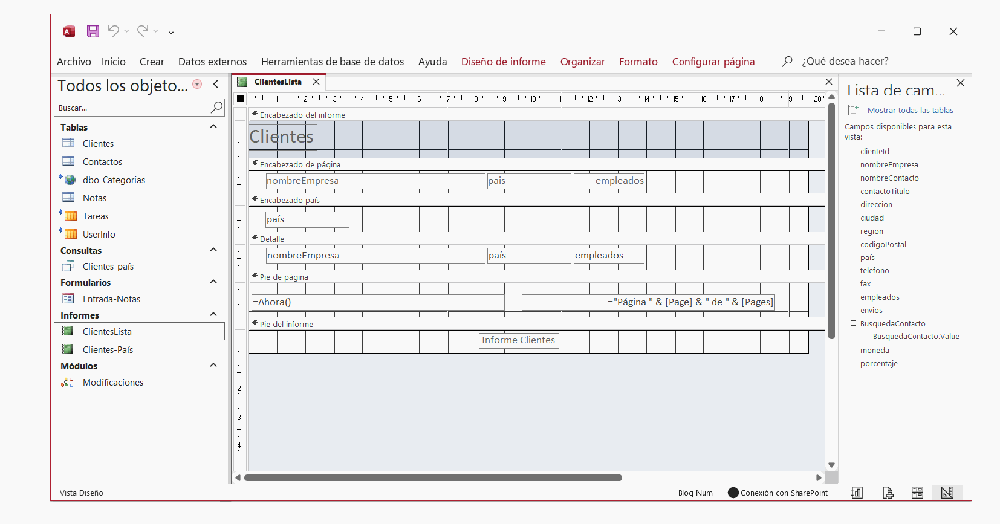

**2024I0B-1-35** (2024I0B-1-35)

De las siguientes opciones propuestas, ¿cuál es correcta con respecto a la forma en que se mostrará en la vista preliminar el informe?

- Respuesta: En la primera página se mostrará primero el texto “Clientes”; a continuación los nombres de los campos; después el nombre de cada país y los valores correspondientes para cada cliente de sus campos “nombreEmpresa”, “pais”, y “empleados”. Al final de cada página se mostrará la fecha y hora según el formato aplicado, y un texto con la estructura “Página <número de página> de <total de páginas>”.
- **En la primera página se mostrará primero el texto “Clientes”; a continuación los nombres de los campos; luego el nombre de cada país y los valores correspondientes para cada cliente de sus campos “nombreEmpresa”, “pais”, y “empleados”. La fecha y hora según el formato aplicado, y un texto con la estructura “Página <número de página> de <total de páginas>”, se mostrará sólo en la última página del informe, en el pie de página.**
- En la primera página se mostrará primero el texto “Clientes”; a continuación el nombre de cada país y los valores correspondientes para cada cliente de sus campos “nombreEmpresa”, “pais”, y “empleados”; después los nombres de los campos. Al final de cada página se mostrará la fecha y hora según el formato aplicado, y un texto con la estructura “Página <número de página> de <total de páginas>”.
- Cada página del informe mostrará primero el texto “Clientes”; después el nombre de cada país y los valores correspondientes para cada cliente de sus campos “nombreEmpresa”, “pais”, y “empleados”; a continuación los nombres de los campos. Al final de cada página se mostrará la fecha y hora según el formato aplicado, y un texto con la estructura “Página <número de página> de <total de páginas>”.

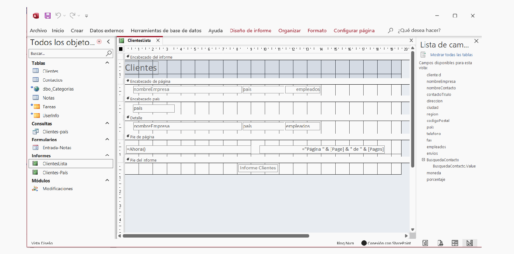

### 2024I0A-1-38 ↔ 2024I0B-1-38 (text)

**2024I0A-1-38** (2024I0A-1-38)

Tenemos que aplazar el envío de la convocatoria de reuniones durante un par de horas. En dicha convocatoria hemos realizado algunos cambios. En este caso, ¿podemos **guardarla** para enviarla más adelante?

- Respuesta: Sí, al seleccionar la opción cerrar desde el aspa nos permite guardar los cambios sin enviarlos a los destinatarios, quedando disponible para cuando se pueda enviar.
- No, hay que redactar una nueva convocatoria.
- No, únicamente permite guardar los cambios y enviar la reunión.
- Sí, al seleccionar la opción Asistente para programación nos permite guardar los cambios en una carpeta específica, quedando disponible para cuando se pueda enviar.

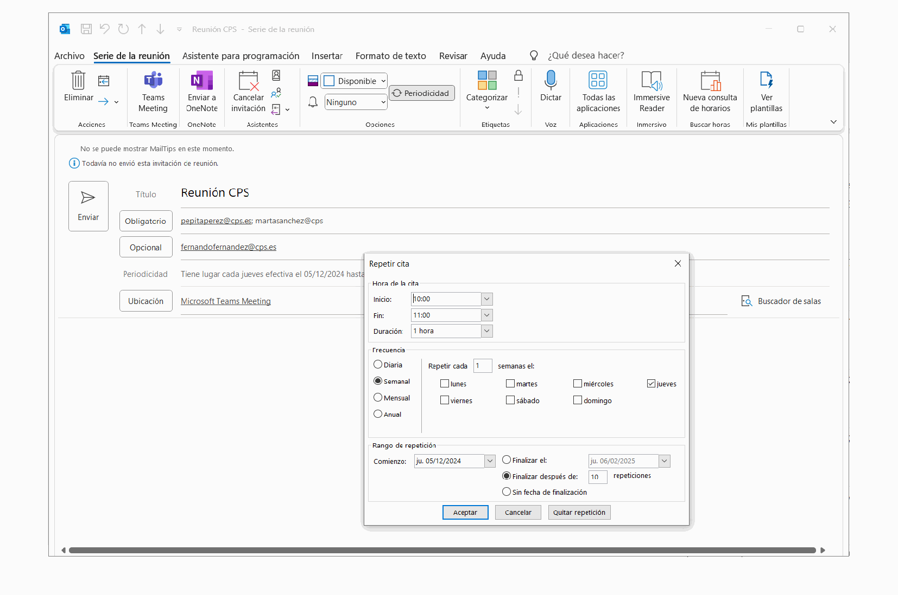

**2024I0B-1-38** (2024I0B-1-38)

Tenemos que aplazar el envío de la convocatoria de reuniones durante un par de horas. En dicha convocatoria hemos realizado algunos cambios. En este caso, ¿podemos **guardar la convocatoria** para enviarla más adelante?

- Respuesta: Sí, al seleccionar la opción cerrar desde el aspa nos permite guardar los cambios sin enviarlos a los destinatarios, quedando disponible para cuando se pueda enviar.
- No, hay que redactar una nueva convocatoria.
- No, únicamente permite guardar los cambios y enviar la reunión.
- Sí, al seleccionar la opción Asistente para programación nos permite guardar los cambios en una carpeta específica, quedando disponible para cuando se pueda enviar.

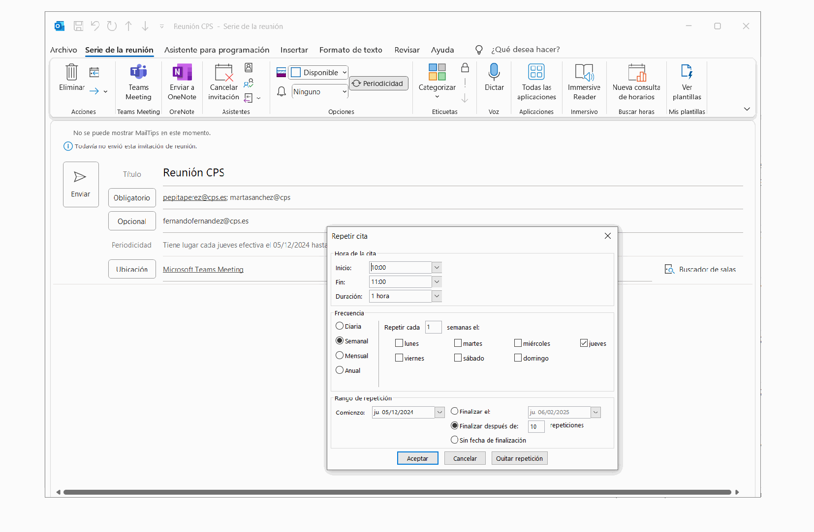

### 2024I0A-1-6 ↔ 2024I0B-1-5 (text)

**2024I0A-1-6** (2024I0A-1-6)

Indique cuál de las siguientes afirmaciones es la **correcta.**

- Respuesta: La velocidad de procesamiento de los microprocesadores se mide en gigahercios (GHz).
- Los teléfonos móviles inteligentes no utilizan sistema operativo.
- Las unidades de estado sólido SSD son un sistema de almacenamiento externo impreciso y muy lento.
- Las siglas LAN hacen referencia a una Red Informática en Línea, según sus iniciales en inglés.

_(sin contexto)_

**2024I0B-1-5** (2024I0B-1-5)

Indique cuál de las siguientes afirmaciones es la **única verdadera.**

- Respuesta: La velocidad de procesamiento de los microprocesadores se mide en gigahercios (GHz).
- Los teléfonos móviles inteligentes no utilizan sistema operativo.
- Las unidades de estado sólido SSD son un sistema de almacenamiento externo impreciso y muy lento.
- Las siglas LAN hacen referencia a una Red Informática en Línea, según sus iniciales en inglés.

_(sin contexto)_

### 2024L0A-1-49 ↔ 2024L0A-1-53 (text)

**2024L0A-1-49** (2024L0A-1-49)

Según los datos del cuadro Biblioteca, siendo que la columna Clasificación de ubicación se refiere al nombre del título, ¿en cuál de las siguientes ubicaciones, habría que colocar este libro? Tema: **Derecho Económico.** Nombre: **"Trabajo temporal. Tributación".**

- Respuesta: Planta: **1.** Pasillo: 3 derecha. Estanterías: **1** a **5.**
- **Planta: 1. Pasillo: 2 izquierda. Estanterías: 2 a 5.**
- **Planta: 1. Pasillo: 3 derecha. Estanterías: 2 a 5.**
- **Planta: 2. Pasillo: 2 derecha. Estanterías: 3 a 5.**

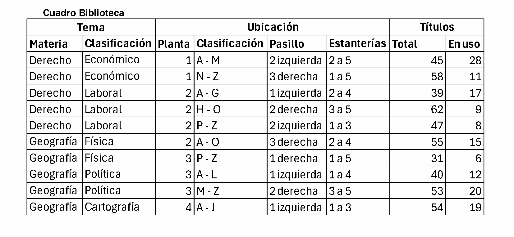

**2024L0A-1-53** (2024L0A-1-53)

Según los datos del cuadro Biblioteca, siendo que la columna Clasificación de ubicación se refiere al nombre del título, ¿en cuál de las siguientes ubicaciones, habría que colocar este libro? Tema: **Geografía física.** Nombre: **"Cordilleras asiáticas".**

- Respuesta: Planta: **2.** Pasillo: 3 derecha. Estanterías: **2** a **4.**
- **Planta: 3 Pasillo: 1 derecha. Estanterías: 1 a 4.**
- **Planta: 2 Pasillo: 2 derecha. Estanterías: 3 a 5.**
- **Planta: 3 Pasillo: 1 derecha. Estanterías: 1 a 5.**

### 2024L0A-1-49 ↔ 2024L0B-1-52 (text)

**2024L0A-1-49** (2024L0A-1-49)

Según los datos del cuadro Biblioteca, siendo que la columna Clasificación de ubicación se refiere al nombre del título, ¿en cuál de las siguientes ubicaciones, habría que colocar este libro? Tema: **Derecho Económico.** Nombre: **"Trabajo temporal. Tributación".**

- Respuesta: Planta: **1.** Pasillo: 3 derecha. Estanterías: **1** a **5.**
- **Planta: 1. Pasillo: 2 izquierda. Estanterías: 2 a 5.**
- **Planta: 1. Pasillo: 3 derecha. Estanterías: 2 a 5.**
- **Planta: 2. Pasillo: 2 derecha. Estanterías: 3 a 5.**

**2024L0B-1-52** (2024L0B-1-52)

Según los datos del cuadro Biblioteca, siendo que la columna Clasificación de ubicación se refiere al nombre del título, ¿en cuál de las siguientes ubicaciones, habría que colocar este libro? Tema: **Geografía física.** Nombre: **"Cordilleras asiáticas".**

- Respuesta: Planta: **2.** Pasillo: 3 derecha. Estanterías: **2** a **4.**
- **Planta: 3 Pasillo: 1 derecha. Estanterías: 1 a 4.**
- **Planta: 2 Pasillo: 2 derecha. Estanterías: 3 a 5.**
- **Planta: 3 Pasillo: 1 derecha. Estanterías: 1 a 5.**

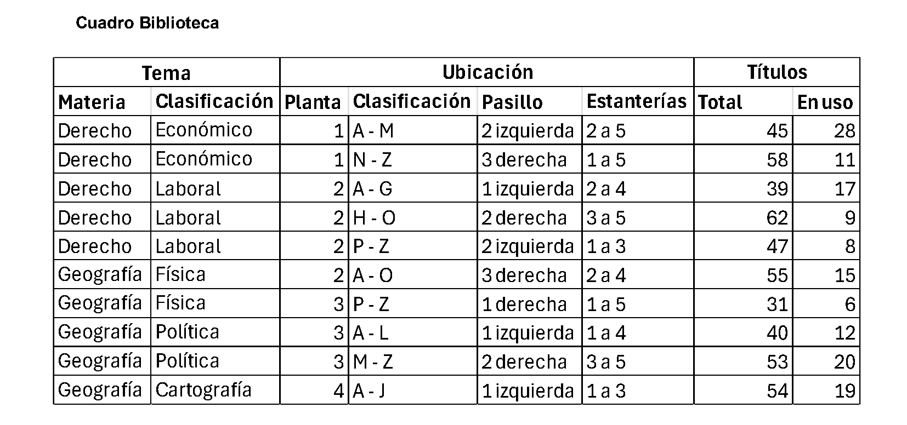

### 2024L0A-1-53 ↔ 2024L0B-1-49 (text)

**2024L0A-1-53** (2024L0A-1-53)

Según los datos del cuadro Biblioteca, siendo que la columna Clasificación de ubicación se refiere al nombre del título, ¿en cuál de las siguientes ubicaciones, habría que colocar este libro? Tema: **Geografía física.** Nombre: **"Cordilleras asiáticas".**

- Respuesta: Planta: **2.** Pasillo: 3 derecha. Estanterías: **2** a **4.**
- **Planta: 3 Pasillo: 1 derecha. Estanterías: 1 a 4.**
- **Planta: 2 Pasillo: 2 derecha. Estanterías: 3 a 5.**
- **Planta: 3 Pasillo: 1 derecha. Estanterías: 1 a 5.**

**2024L0B-1-49** (2024L0B-1-49)

Según los datos del cuadro Biblioteca, siendo que la columna Clasificación de ubicación se refiere al nombre del título, ¿en cuál de las siguientes ubicaciones, habría que colocar este libro? Tema: **Derecho Económico.** Nombre: **"Trabajo temporal. Tributación".**

- Respuesta: Planta: **1.** Pasillo: 3 derecha. Estanterías: **1** a **5.**
- **Planta: 1. Pasillo: 2 izquierda. Estanterías: 2 a 5.**
- **Planta: 1. Pasillo: 3 derecha. Estanterías: 2 a 5.**
- **Planta: 2. Pasillo: 2 derecha. Estanterías: 3 a 5.**

### 2024L0B-1-16 ↔ 2024L0X-1-16 (text)

**2024L0B-1-16** (2024L0A-1-15, 2024L0B-1-16)

Según **lo dispuesto en** la Ley 40/2015, de 1 de octubre, de Régimen Jurídico del Sector **Público,** en la Administración General del Estado en el **exterior son órganos directivos:**

- Respuesta: **Los** embajadores y representantes permanentes ante Organizaciones internacionales.
- **El Consejero de Política Exterior, los embajadores y representantes permanentes ante Organizaciones internacionales.**
- **El Consejero Ejecutivo de Política Exterior, los embajadores y representantes permanentes ante Organizaciones internacionales.**
- **Los embajadores y representantes permanentes ante Organizaciones internacionales y el jefe de la oficina consular.**

_(sin contexto)_

**2024L0X-1-16** (2024L0X-1-16)

Según la Ley 40/2015, de 1 de octubre, de Régimen Jurídico del Sector **Público** en la Administración General del Estado en el **exterior:**

- Respuesta: **Son órganos directivos los** embajadores y representantes permanentes ante **las** Organizaciones internacionales.
- **Son órganos superiores los embajadores y representantes permanentes ante las Organizaciones internacionales.**
- **No existen órganos superiores ni directivos.**
- **Los embajadores son órganos superiores y los representantes permanentes ante las Organizaciones internacionales son órganos directivos.**

_(sin contexto)_

### 2024L0B-1-49 ↔ 2024L0B-1-52 (text)

**2024L0B-1-49** (2024L0B-1-49)

Según los datos del cuadro Biblioteca, siendo que la columna Clasificación de ubicación se refiere al nombre del título, ¿en cuál de las siguientes ubicaciones, habría que colocar este libro? Tema: **Derecho Económico.** Nombre: **"Trabajo temporal. Tributación".**

- Respuesta: Planta: **1.** Pasillo: 3 derecha. Estanterías: **1** a **5.**
- **Planta: 1. Pasillo: 2 izquierda. Estanterías: 2 a 5.**
- **Planta: 1. Pasillo: 3 derecha. Estanterías: 2 a 5.**
- **Planta: 2. Pasillo: 2 derecha. Estanterías: 3 a 5.**

**2024L0B-1-52** (2024L0B-1-52)

Según los datos del cuadro Biblioteca, siendo que la columna Clasificación de ubicación se refiere al nombre del título, ¿en cuál de las siguientes ubicaciones, habría que colocar este libro? Tema: **Geografía física.** Nombre: **"Cordilleras asiáticas".**

- Respuesta: Planta: **2.** Pasillo: 3 derecha. Estanterías: **2** a **4.**
- **Planta: 3 Pasillo: 1 derecha. Estanterías: 1 a 4.**
- **Planta: 2 Pasillo: 2 derecha. Estanterías: 3 a 5.**
- **Planta: 3 Pasillo: 1 derecha. Estanterías: 1 a 5.**

### 2024L0B-1R-3 ↔ 2025L0B-1-34 (text)

**2024L0B-1R-3** (2024L0A-1R-3, 2024L0B-1R-3)

Indique entre las siguientes palabras cuál es el antónimo de la palabra VENTURA.

- Respuesta: Desdicha.
- **Aireado.**
- **Quimerista.**
- **Peligroso.**

_(sin contexto)_

**2025L0B-1-34** (2025L0A-1-36, 2025L0B-1-34)

Indique entre las siguientes palabras cuál es el antónimo **u opuesto** de la palabra VENTURA.

- Respuesta: Desdicha.
- **Suerte.**
- **Destino.**
- **Azar.**

_(sin contexto)_

### 2024L0X-1-29 ↔ 2025L0B-1-30 (options)

**2024L0X-1-29** (2024L0X-1-29)

El artículo 28 de la Ley **47/2003,** de 26 de noviembre, General **Presupuestaria** establece que los escenarios presupuestarios plurianuales en los que se enmarcarán anualmente los Presupuestos Generales del Estado serán confeccionados por:

- Respuesta: El Ministerio de Hacienda.
- El Consejo de Ministros.
- **El Ministerio de Economía , Comercio y Empresa.**
- Las Cortes Generales.

_(sin contexto)_

**2025L0B-1-30** (2025L0A-1-28, 2025L0B-1-30)

El artículo 28 de la Ley **47/2003** de 26 de noviembre, General **Presupuestaria,** establece que los escenarios presupuestarios plurianuales en los que se enmarcarán anualmente los Presupuestos Generales del Estado serán confeccionados por:

- Respuesta: El Ministerio de Hacienda.
- El Consejo de Ministros.
- **El Ministerio de Economía, Comercio y Empresa.**
- Las Cortes Generales.

_(sin contexto)_

### 2024L0X-1-36 ↔ 2024L0X-1R-4 (text)

**2024L0X-1-36** (2024L0X-1-36)

**Halle** el valor de x en la siguiente ecuación: 13(7x-64) = 2x

- Respuesta: 9,35
- 112,34
- 13,52
- 29,93

_(sin contexto)_

**2024L0X-1R-4** (2024L0X-1R-4)

**Halla** el valor de x en la siguiente ecuación: 13(7x-64) = 2x

- Respuesta: 9,35
- 112,34
- 13,52
- 29,93

_(sin contexto)_

### 2024L0X-2-35 ↔ 2025I0B-1-5 (text)

**2024L0X-2-35** (2024L0X-2-35)

¿Cuál de los siguientes elementos tiene como tarea procesar datos y transformarlos en información representable en el dispositivo de salida?

- Respuesta: Tarjeta gráfica.
- Sistema de archivos.
- Firewall.
- Disco duro.

_(sin contexto)_

**2025I0B-1-5** (2025I0A-1-2, 2025I0B-1-5)

¿Cuál de los siguientes elementos tiene como tarea procesar **los** datos **de la CPU** y transformarlos en información representable en el dispositivo de salida?

- Respuesta: Tarjeta gráfica.
- Sistema de archivos.
- Firewall.
- Disco duro.

_(sin contexto)_

### 2025I0A-1-20 ↔ 2025I0B-1-19 (text)

**2025I0A-1-20** (2025I0A-1-20)

El archivo de texto que contiene información sobre la actividad del usuario y es enviado por un sitio web y almacenado en el navegador se denomina:

- Respuesta: Cookie.
- Word.
- Imagen jpg.
- Fichero de sistema.

_(sin contexto)_

**2025I0B-1-19** (2025I0B-1-19)

El archivo de texto que contiene **la** información sobre la actividad del usuario y es enviado por un sitio web y almacenado en el navegador se denomina:

- Respuesta: Cookie.
- Word.
- Imagen jpg.
- Fichero de sistema.

_(sin contexto)_

### 2025I0A-1-21 ↔ 2025I0B-1-21 (options)

**2025I0A-1-21** (2025I0A-1-21)

¿En cuál de las siguientes palabras del texto se ha creado un hipervínculo utilizando el formato por defecto?

- Respuesta: **articulación**
- medicina
- **Luxación**
- dislocación

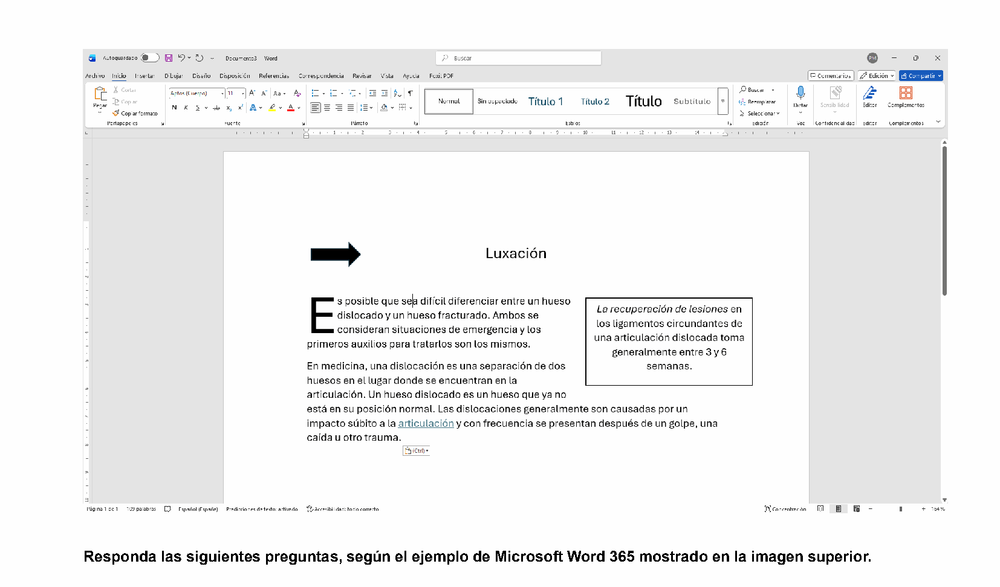

**2025I0B-1-21** (2025I0B-1-21)

¿En cuál de las siguientes palabras del texto se ha creado un hipervínculo utilizando el formato por defecto?

- Respuesta: **articulación.**
- medicina.
- **luxación.**
- dislocación.

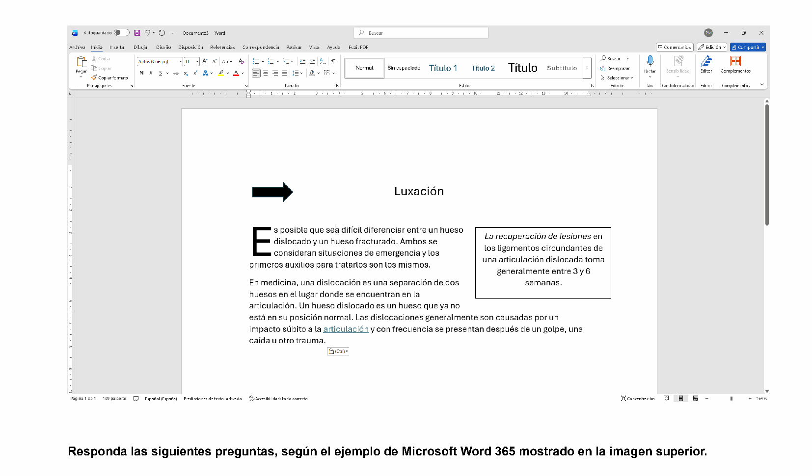

### 2025I0A-1-3 ↔ 2025I0B-1-1 (text)

**2025I0A-1-3** (2025I0A-1-3)

¿Cuál es **una de las funciones principales** de la BIOS?

- Respuesta: Inicializar y testear el hardware y cargar el sistema operativo.
- Escanear y reparar la integridad de los discos.
- Actualizar la RAM.
- Gestionar la entrada y salida de operaciones del microprocesador.

_(sin contexto)_

**2025I0B-1-1** (2025I0B-1-1)

¿Cuál es **la función principal** de la BIOS?

- Respuesta: Inicializar y testear el hardware y cargar el sistema operativo.
- Escanear y reparar la integridad de los discos.
- Actualizar la RAM.
- Gestionar la entrada y salida de operaciones del microprocesador.

_(sin contexto)_

### 2025I0B-1-10 ↔ 2025L0B-2-24 (options)

**2025I0B-1-10** (2025I0B-1-10)

¿Cuál de las siguientes afirmaciones es correcta sobre un archivo en un sistema operativo actual?

- Respuesta: Se identifica mediante un nombre y puede tener una extensión.
- Es un conjunto de información volátil que se pierde al apagar el equipo.
- **Sólo existe mientras una aplicación está en ejecución.**
- No puede organizarse dentro de carpetas.

_(sin contexto)_

**2025L0B-2-24** (2025I0A-1-9, 2025L0A-2-24, 2025L0B-2-24)

¿Cuál de las siguientes afirmaciones es correcta sobre un archivo en un sistema operativo actual?

- Respuesta: Se identifica mediante un nombre y puede tener una extensión.
- Es un conjunto de información volátil que se pierde al apagar el equipo.
- **Solo existe mientras una aplicación está en ejecución.**
- No puede organizarse dentro de carpetas.

_(sin contexto)_

### 2025L0A-1-18 ↔ 2025L0B-1-17 (options)

**2025L0A-1-18** (2025L0A-1-18)

De conformidad con la Ley 39/2015, de 1 de octubre, del Procedimiento Administrativo Común de las Administraciones Públicas, en los procedimientos iniciados a solicitud del interesado, ¿qué consecuencia produciría el vencimiento del plazo máximo sin haberse notificado resolución **expresa?**

- Respuesta: Legitimaría al interesado o interesados para entenderla estimada por silencio administrativo, excepto en los supuestos en los que una norma con rango de ley o una norma de Derecho de la Unión Europea o de Derecho internacional aplicable en España establezcan lo contrario.
- **El silencio tendría efecto estimatorio si se trata de un procedimiento relativo al ejercicio del derecho de petición, a que se refiere el artículo 29 de la Constitución.**
- Legitimaría al interesado o interesados para entenderla desestimada por silencio administrativo, excepto en los supuestos en los que una norma con rango de ley o una norma de Derecho de la Unión Europea o de Derecho internacional aplicable en España establezcan lo contrario.
- En los casos de estimación por silencio administrativo, la resolución expresa posterior al vencimiento del plazo se adoptará por la Administración sin vinculación alguna al sentido del silencio.

_(sin contexto)_

**2025L0B-1-17** (2025L0B-1-17)

De conformidad con la Ley 39/2015, de 1 de octubre, del Procedimiento Administrativo Común de las Administraciones Públicas, en los procedimientos iniciados a solicitud del interesado, ¿qué consecuencia produciría el vencimiento del plazo máximo sin haberse notificado resolución **expresa?:**

- Respuesta: Legitimaría al interesado o interesados para entenderla estimada por silencio administrativo, excepto en los supuestos en los que una norma con rango de ley o una norma de Derecho de la Unión Europea o de Derecho internacional aplicable en España establezcan lo contrario.
- **El silencio tendría efecto estimatorio en los procedimientos relativos al ejercicio del derecho de petición, a que se refiere el artículo 29 de la Constitución.**
- Legitimaría al interesado o interesados para entenderla desestimada por silencio administrativo, excepto en los supuestos en los que una norma con rango de ley o una norma de Derecho de la Unión Europea o de Derecho internacional aplicable en España establezcan lo contrario.
- En los casos de estimación por silencio administrativo, la resolución expresa posterior al vencimiento del plazo se adoptará por la Administración sin vinculación alguna al sentido del silencio.

_(sin contexto)_

### 2025L0A-1-24 ↔ 2025L0B-1-22 (text)

**2025L0A-1-24** (2025L0A-1-24)

Conforme al artículo 88.2 del Real Decreto Legislativo 5/2015, **de 30 de octubre,** por el que se aprueba el texto refundido de la Ley del Estatuto Básico del Empleado Público, ¿en qué situación se encuentran los funcionarios transferidos a las Comunidades Autónomas en la función pública en la que se integran?

- Respuesta: Servicio activo.
- Servicios en otras Administraciones Públicas.
- Servicios especiales.
- Servicios en Comunidades Autónomas.

_(sin contexto)_

**2025L0B-1-22** (2025L0B-1-22)

Conforme al artículo 88.2 del Real Decreto Legislativo 5/2015, por el que se aprueba el texto refundido de la Ley del Estatuto Básico del Empleado Público, ¿en qué situación se encuentran los funcionarios transferidos a las Comunidades Autónomas en la función pública en la que se integran?

- Respuesta: Servicio activo.
- Servicios en otras Administraciones Públicas.
- Servicios especiales.
- Servicios en Comunidades Autónomas.

_(sin contexto)_

### 2025L0A-1-3 ↔ 2025L0B-1-2 (options)

**2025L0A-1-3** (2025L0A-1-3)

Conforme al artículo 167.1 de la Constitución Española de 1978, los proyectos de reforma constitucional deberán ser aprobados por:

- Respuesta: Una mayoría de tres quintos de cada una de las Cámaras.
- **Mayoría absoluta de cada una de las Cámaras.**
- **Una mayoría de dos tercios de ambas Cámaras.**
- Una mayoría de dos tercios del Senado y mayoría absoluta del Congreso.

_(sin contexto)_

**2025L0B-1-2** (2025L0B-1-2)

Conforme al artículo 167.1 de la Constitución Española de 1978, los proyectos de reforma constitucional deberán ser aprobados por:

- Respuesta: Una mayoría de tres quintos de cada una de las Cámaras.
- **Mayoría absoluta de cada una de las cámaras.**
- **Una mayoría de dos tercios de ambas cámaras.**
- Una mayoría de dos tercios del Senado y mayoría absoluta del Congreso.

_(sin contexto)_

### 2025L0A-2-12 ↔ 2025L0B-2-11 (options)

**2025L0A-2-12** (2025L0A-2-12)

Según la ISO/IEC 27000, el conjunto de elementos interrelacionados o interactuantes que utiliza una organización para establecer una política y unos objetivos de seguridad de la información y alcanzar dichos objetivos, basándose en un enfoque de gestión del riesgo y de mejora continua, ¿qué nombre recibe?

- Respuesta: Sistema de Gestión de la Seguridad de la Información.
- Sistema de Información.
- Seguridad de la Información.
- **Gestión de Incidentes de Seguridad de la Información.**

_(sin contexto)_

**2025L0B-2-11** (2025L0B-2-11)

Según la ISO/IEC 27000, el conjunto de elementos interrelacionados o interactuantes que utiliza una organización para establecer una política y unos objetivos de seguridad de la información y alcanzar dichos objetivos, basándose en un enfoque de gestión del riesgo y de mejora continua, ¿qué nombre recibe?

- Respuesta: Sistema de Gestión de la Seguridad de la Información.
- Sistema de Información.
- Seguridad de la Información.
- **Gestión de incidentes de Seguridad de la Información.**

_(sin contexto)_

### 2025L0A-2-2 ↔ 2025L0B-2-1 (text)

**2025L0A-2-2** (2025L0A-2-2)

**¿Cuándo** y en qué sentido se reformó la Constitución Española **de 1978** en **garantía** de los derechos de las personas con discapacidad para la igualdad real?

- Respuesta: En 2024 y sustituyó el termino disminuidos por personas con discapacidad.
- En 2024 y sustituyó el termino minusválido por personas con discapacidad.
- En 2023 y sustituyó el término minusválido por personas con discapacidad.
- En 2023 y sustituyó el término disminuido por personas con discapacidad.

_(sin contexto)_

**2025L0B-2-1** (2025L0B-2-1)

**¿Cuando** y en qué sentido se reformó la Constitución Española en **garantia** de los derechos de las personas con discapacidad para la igualdad real?

- Respuesta: En 2024 y sustituyó el termino disminuidos por personas con discapacidad.
- En 2024 y sustituyó el termino minusválido por personas con discapacidad.
- En 2023 y sustituyó el término minusválido por personas con discapacidad.
- En 2023 y sustituyó el término disminuido por personas con discapacidad.

_(sin contexto)_

### 2025L0A-2-26 ↔ 2025L0B-2-28 (options)

**2025L0A-2-26** (2025L0A-2-26)

Para utilizar una aplicación diferente a la que tiene asociada el archivo por defecto, ¿cuál es el procedimiento que permite cambiar la aplicación predeterminada para abrir un tipo de archivo específico en Windows 11?

- Respuesta: Hacer clic con el botón derecho sobre el archivo, en el menú seleccionar el comando “Abrir con”, elegir una aplicación propuesta, o en su caso, seleccionar “Elegir otra aplicación” y seleccionar la aplicación correspondiente.
- **Hacer clic con el botón derecho sobre el archivo, en el menú seleccionar el comando “Propiedades”, hacer clic en la pestaña “Personalizar”, en el grupo “Iconos de carpeta” seleccionar “Cambiar icono…” y, por último, “Elegir otra aplicación” y seleccionar la aplicación correspondiente.**
- Hacer clic en “Inicio”, seleccionar “Configuración”, en el menú lateral izquierdo seleccionar la sección “Aplicaciones”, en el panel principal seleccionar la opción “Configuración avanzada de aplicaciones” y, por último, hacer clic en “Elegir otra aplicación” y seleccionar la aplicación correspondiente.
- Hacer clic en “Inicio”, escribir “Panel de Control”, seleccionar “Opciones del Explorador de archivos”, en la pestaña “General” ir a la sección “Acciones al hacer clic en un elemento”, seleccionar “Elegir otra aplicación” y seleccionar la aplicación correspondiente.

_(sin contexto)_

**2025L0B-2-28** (2025L0B-2-28)

Para utilizar una aplicación diferente a la que tiene asociada el archivo por defecto, ¿cuál es el procedimiento que permite cambiar la aplicación predeterminada para abrir un tipo de archivo específico en Windows 11?

- Respuesta: Hacer clic con el botón derecho sobre el archivo, en el menú seleccionar el comando “Abrir con”, elegir una aplicación propuesta, o en su caso, seleccionar “Elegir otra aplicación” y seleccionar la aplicación correspondiente.
- **Hacer clic con el botón derecho sobre el archivo, en el menú seleccionar el comando “Propiedades”, hacer clic en la pestaña “Personalizar”, en el grupo “Íconos de carpeta” seleccionar “Cambiar icono…” y, por último, “Elegir otra aplicación” y seleccionar la aplicación correspondiente.**
- Hacer clic en “Inicio”, seleccionar “Configuración”, en el menú lateral izquierdo seleccionar la sección “Aplicaciones”, en el panel principal seleccionar la opción “Configuración avanzada de aplicaciones” y, por último, hacer clic en “Elegir otra aplicación” y seleccionar la aplicación correspondiente.
- Hacer clic en “Inicio”, escribir “Panel de Control”, seleccionar “Opciones del Explorador de archivos”, en la pestaña “General” ir a la sección “Acciones al hacer clic en un elemento”, seleccionar “Elegir otra aplicación” y seleccionar la aplicación correspondiente.

_(sin contexto)_

### 2025L0A-2-32 ↔ 2025L0B-2-33 (text)

**2025L0A-2-32** (2025L0A-2-32)

En una hoja de Microsoft Excel 365, donde la Columna A es Fecha, Columna B es Concepto, Columna C es Importe, ¿qué valores se **sumarán si se utiliza la siguiente fórmula? =SUMAR.SI.CONJUNTO(C2:C6;B2:B6;"Nómina";C2:C6;">2000";A2:A6;">=01/01/2025";A2:A6;"<=31/12/2025")**

- Respuesta: Sumará los importes correspondientes a nóminas con importe superior a 2.000 € **y** cuyas fechas estén comprendidas en el año 2025.
- Sumará los importes mayores a 2.000 € del año 2025, siempre que la celda de concepto contenga el texto “Nómina”, aunque no coincida exactamente.
- Sumará los importes de nómina del año 2025 y, además, los importes superiores a 2.000 € de otros conceptos distintos de nómina.
- No devolverá ningún resultado, ya que el rango de suma y uno de los rangos de criterio son el mismo, lo cual provoca un error.

_(sin contexto)_

**2025L0B-2-33** (2025L0B-2-33)

En una hoja de Microsoft Excel 365, donde la Columna A es Fecha, Columna B es Concepto, Columna C es Importe, se utiliza la **fórmula =SUMAR.SI.CONJUNTO(C2:C6;B2:B6;"Nómina";C2:C6;">2000";A2:A6;">=01/01/2025";A2:A6;"<=31/12/2025"), ¿qué valores se sumarán?**

- Respuesta: Sumará los importes correspondientes a nóminas con importe superior a 2.000 € cuyas fechas estén comprendidas en el año 2025.
- Sumará los importes mayores a 2.000 € del año 2025, siempre que la celda de concepto contenga el texto “Nómina”, aunque no coincida exactamente.
- Sumará los importes de nómina del año 2025 y, además, los importes superiores a 2.000 € de otros conceptos distintos de nómina.
- No devolverá ningún resultado, ya que el rango de suma y uno de los rangos de criterio son el mismo, lo cual provoca un error.

_(sin contexto)_

### 2025L0A-2-5 ↔ 2025L0B-2-6 (options)

**2025L0A-2-5** (2025L0A-2-5)

Tal y como indica el Real Decreto 951/2005, de 29 de julio, por el que se establece el marco general para la mejora de la calidad en la Administración General del Estado, las cartas de servicios y sus posteriores actualizaciones serán aprobadas mediante:

- Respuesta: Resolución del Subsecretario del departamento al que pertenezca el órgano y se publicará en el Boletín Oficial del Estado.
- **Resolución del Subsecretario del departamento al que pertenezca el órgano, no será necesaria la publicación en Boletín Oficial del Estado, pero sí se llevarán a cabo las acciones divulgativas más eficaces, garantizando siempre que puedan ser conocidas por los usuarios en todas sus dependencias con atención al público.**
- Orden Ministeral del departamento al que pertenezca el órgano y se publicará en el Boletín Oficial del Estado.
- **Orden Ministerial del departamento al que pertenezca el órgano sin que sea necesaria la publicacion en el Boletín Oficial del Estado, pero se llevarán a cabo las acciones divulgativas más eficaces, garantizando siempre que puedan ser conocidas por los usuarios en todas sus dependencias con atención al público.**

_(sin contexto)_

**2025L0B-2-6** (2025L0B-2-6)

Tal y como indica el Real Decreto 951/2005, de 29 de julio, por el que se establece el marco general para la mejora de la calidad en la Administración General del Estado, las cartas de servicios y sus posteriores actualizaciones serán aprobadas mediante:

- Respuesta: Resolución del Subsecretario del departamento al que pertenezca el órgano y se publicará en el Boletín Oficial del Estado.
- **Resolución del Subsecretario del departamento al que pertenezca el órgano, no será necesaria la publicacion en el Boletín Oficial del Estado, pero sí se llevarán a cabo las acciones divulgativas más eficaces, garantizando siempre que puedan ser conocidas por los usuarios en todas sus dependencias con atención al público.**
- Orden Ministeral del departamento al que pertenezca el órgano y se publicará en el Boletín Oficial del Estado.
- **Orden Ministerial del departamento al que pertenezca el órgano sin que sea necesaria la publicación en el Boletín Oficial del Estado, pero se llevarán a cabo las acciones divulgativas más eficaces, garantizando siempre que puedan ser conocidas por los usuarios en todas sus dependencias con atención al público.**

_(sin contexto)_

## Contextos pendientes (15)

### contexts/2019E0A_p5.png ↔ contexts/2019L0A_p5.png

- De las salas de clases que cuentan con proyector y disponibilidad por las mañanas, ¿cuál tiene mayor capacidad de alumnos?
- ¿Cuál de estas salas está disponible por las mañanas, con capacidad para más de 15 personas y tiene equipos informáticos suficientes para la capacidad máxima de alumnos de la sala?
- ¿Cuál es la sala de reuniones, que no cuenta con toma de red, tiene disponibilidad por las mañanas y decoración tipo estándar?
- ¿Cuántas salas disponen de proyector, tienen decoración estándar y cuentan con toma de red?
- ¿Cuántos metros cuadrados en total hay disponibles en salas con proyector y decoración tipo ejecutiva por las tardes?
- ¿Qué media de capacidad de alumnos tienen las salas que cuentan con proyector y toma de red y tienen decoración tipo ejecutiva?

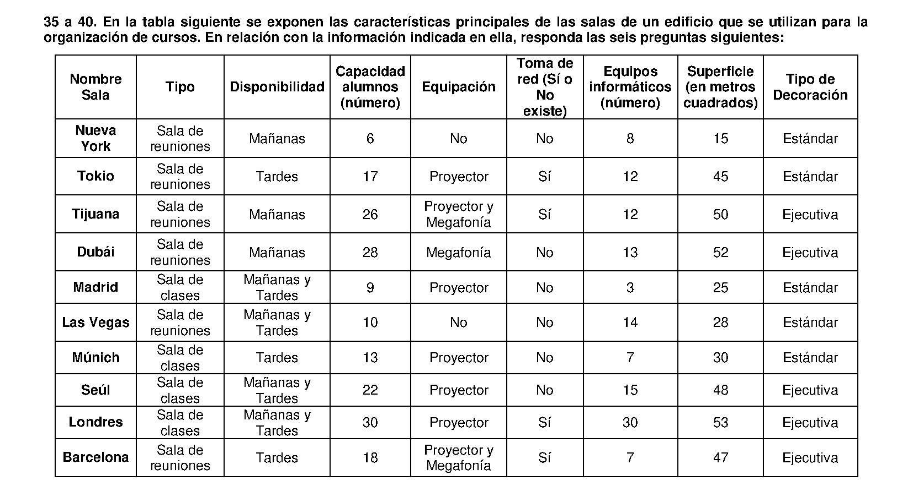

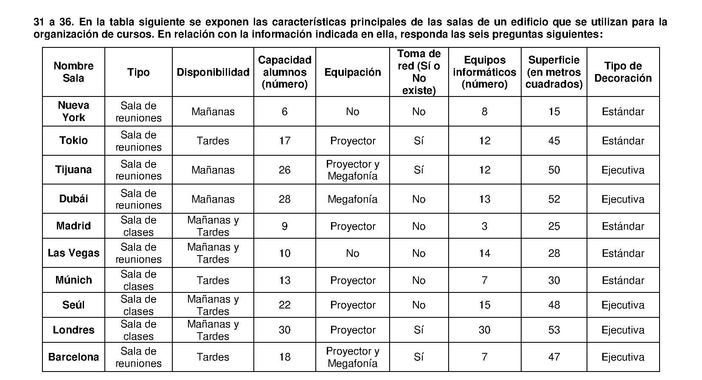

### contexts/2019E0X_p4.png ↔ contexts/2019L0X_p6.png

- ¿Cuál de los siguientes títulos tiene forma facsímil, su calidad original es media y cuya digitalización está terminada?
- ¿Cuál es la fecha de la primera publicación de un diccionario, cuya forma no es Libro, cuya calidad original es media y cuya digitalización está en proceso?
- ¿Cuál es la fecha de la primera publicación de un facsímil con imágenes, la revisión terminada y cuya materia es Retórica y Poética?
- ¿Cuál es la forma del título que tiene la primera fecha de publicación en el siglo XIX, que es un diccionario y no tiene imágenes?
- ¿Cuántos títulos de materia Diccionario tienen la revisión terminada?
- ¿Cuántos títulos publicados por primera vez en el siglo XVIII cuentan con imágenes y su forma es facsímil?

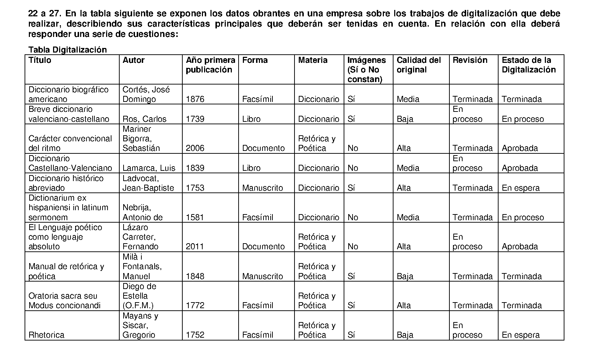

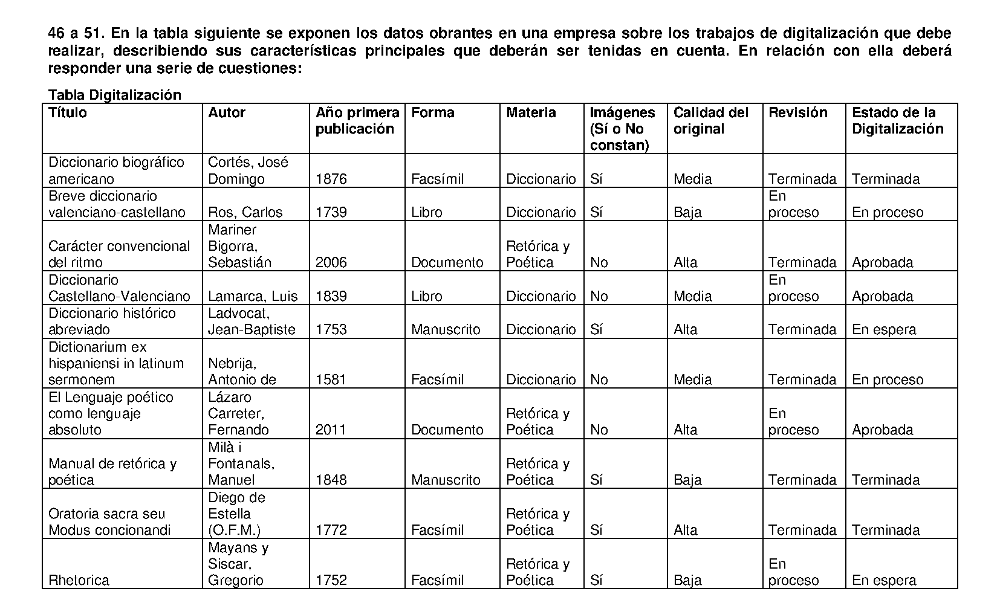

### contexts/2022E0A_p4.png ↔ contexts/2022L0A_p6.png

- Según los datos anteriores de la Tabla Ponencias, ¿cuál es el mínimo de asistentes por la tarde en ponencias de tipo charla?
- Según los datos anteriores de la Tabla Ponencias, ¿cuál es el total de asistentes en el segundo turno de mañana o tarde en una ponencia de tipo Laboratorio donde el tema no fue Recursos Humanos?
- Según los datos anteriores de la Tabla Ponencias, ¿cuántos asistentes acuden en la tarde en la sala 1?
- Según los datos anteriores de la Tabla Ponencias, ¿cuántos asistentes hay que requieren con material Pdf los turnos de tarde en la sala 1?
- Según los datos anteriores de la Tabla Ponencias, ¿cuántos ponentes del segundo turno en mañana y tarde donde el tema fue "Recursos humanos" tienen de material un Cd?
- Según los datos anteriores de la tabla Ponencias, ¿cuál fue el tema que ha tratado en la ponencia con material pdf en el segundo turno de la tarde?
- Según los datos anteriores de la tabla Ponencias, ¿cuántos alumnos hay para cada ponente en la ponencia comercial del segundo turno de tarde?

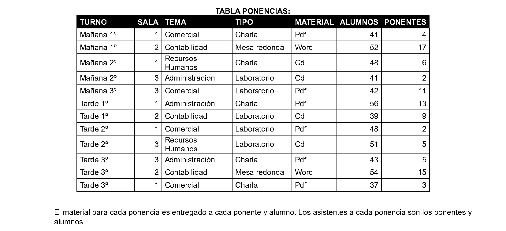

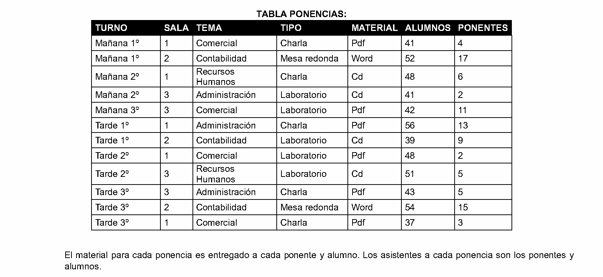

### contexts/2024I0A_p3.png ↔ contexts/2024I0B_p3.png

- Para no repetir a menudo la palabra “población” queremos sustituirla por otra de igual significado o muy parecido. ¿Qué herramienta de Word nos ayuda en este caso?
- Si el texto “Información sobre Sepúlveda” se repite en todas las páginas, ¿en cuál de las siguientes ubicaciones se encuentra?
- ¿Cuál de los siguientes textos tiene la apariencia que Word da por defecto a un hipervínculo?
- ¿Qué formato de los siguientes se ha aplicado al segundo párrafo del texto?
- ¿Qué nombre, de entre los propuestos, recibe el formato de fuente aplicado al texto HOCES DEL RÍO DURATÓN?

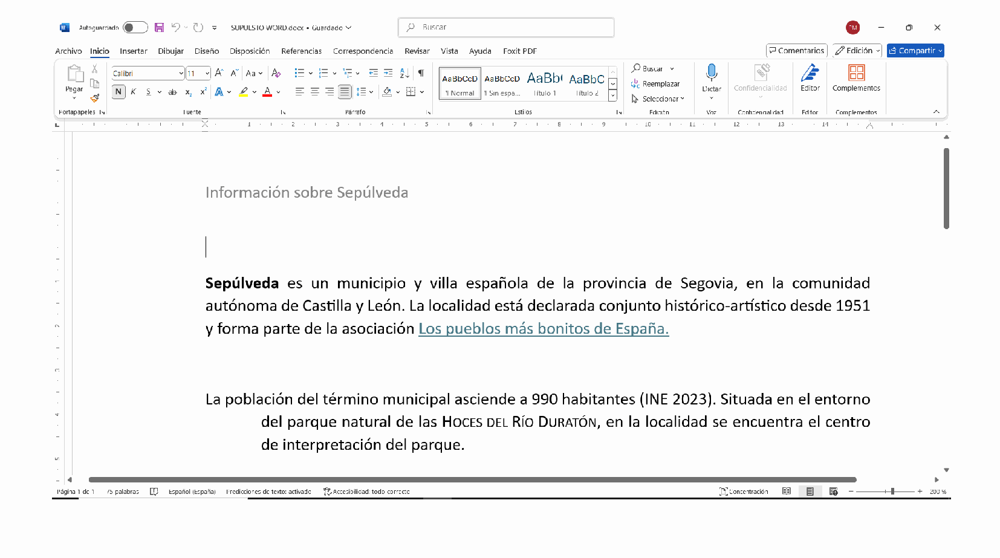

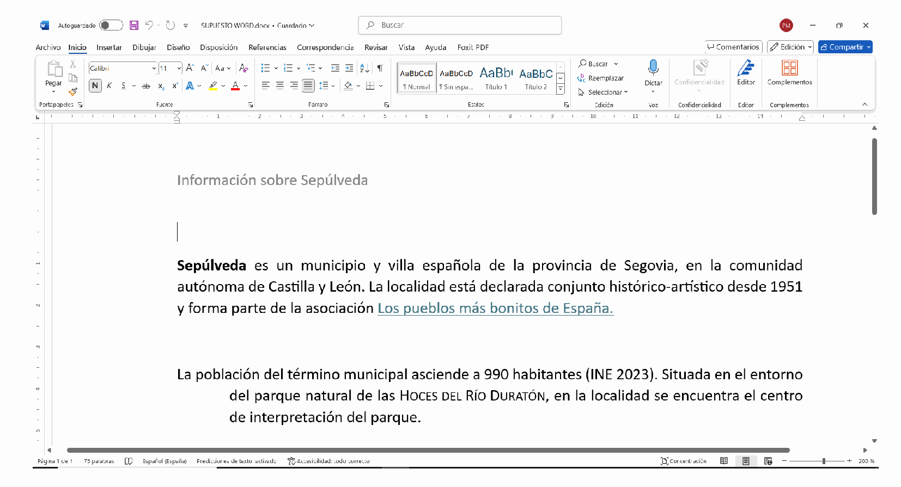

### contexts/2024I0A_p4.png ↔ contexts/2024I0B_p4.png

- Cuál de los siguientes es el tipo de dato y qué personalizaciones se le han aplicado en el formato en la celda I3.
- Indique cuál de las siguientes fórmulas es la aplicada en la celda H3.
- Indique cuál de los siguientes formatos se ha aplicado desde la opción “Bordes” al conjunto de las celdas que contienen los nombres de las columnas en la imagen de Excel llamada Pedidos.
- ¿Cuál de las siguientes fórmulas es la aplicada en la celda F8?
- ¿En qué celda de la imagen de Excel llamada Pedidos está situado el cursor actualmente?

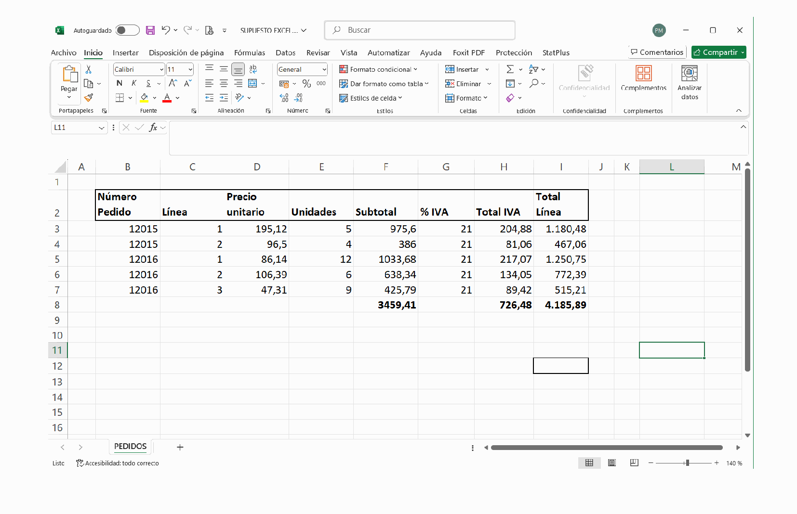

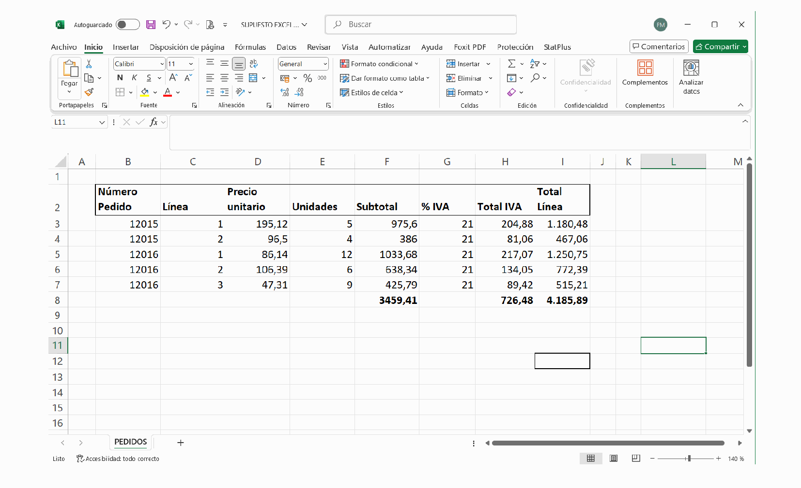

### contexts/2024I0A_p5.png ↔ contexts/2024I0B_p5.png

- De las siguientes opciones propuestas, ¿cuál es correcta con respecto a la forma en que se mostrará en la vista preliminar el informe?
- Indique cuál de las siguientes opciones es correcta con respecto a la forma en que se mostrará en la vista preliminar del informe la expresión: ="Página " & [Page] & " de " & [Pages]
- Según el informe mostrado en la imagen de Access 365, confeccionada con el Asistente para informes, ¿en cuál de las siguientes secciones se muestra el nombre de la tabla o consulta que utiliza el informe como origen de datos?
- ¿Cuál de las siguientes opciones es correcta con respecto a la forma en que se mostrará el texto “Informe Clientes”?
- ¿Cuál de las siguientes opciones es correcta con respecto a la forma en que se mostrará en la vista preliminar del informe la expresión: =Ahora(), suponiendo que se le está aplicando el formato Fecha larga al campo correspondiente?

### contexts/2024I0A_p6.png ↔ contexts/2024I0B_p6.png

- Según la imagen de Outlook 365, queremos programar varias reuniones, la primera el día 5 de diciembre de 2024, con los asistentes que figuran como destinatarios. ¿Cuántas reuniones más, además de la del día 5 de diciembre, estamos programando?
- Según la imagen de Outlook 365, ¿en qué lugar o a través de qué medio está previsto que se celebren las reuniones?
- Tenemos que aplazar el envío de la convocatoria de reuniones durante un par de horas. En dicha convocatoria hemos realizado algunos cambios. En este caso, ¿podemos guardarla para enviarla más adelante?
- Una de las personas que asiste a las reuniones tiene problemas de visión, ¿qué herramienta aparece en la imagen con la que podrá escuchar en voz alta el texto del correo con la convocatoria?
- Una vez enviada la convocatoria de reuniones nos encontramos en la pantalla “Calendario”, ¿qué combinación de teclas emplearemos para ir a la pantalla “Correo” directamente?

### contexts/2024L0A_p6.png ↔ contexts/2024L0B_p6.png

- Según los datos del cuadro Biblioteca, cuál de los siguientes temas tiene un mayor número total de títulos?
- Según los datos del cuadro Biblioteca, siendo que la columna Clasificación de ubicación se refiere al nombre del título, ¿cuál de los siguientes títulos se ubicará en la planta 2, pasillo 1 izquierda, estanterías 2 a 4?
- Según los datos del cuadro Biblioteca, siendo que la columna Clasificación de ubicación se refiere al nombre del título, ¿cuál de los siguientes títulos se ubicará en la planta 3, pasillo 1 izquierda, estanterías 1 a 4?
- Según los datos del cuadro Biblioteca, siendo que la columna Clasificación de ubicación se refiere al nombre del título, ¿en cuál de las siguientes ubicaciones, habría que colocar este libro? Tema: Derecho Económico. Nombre: "Trabajo temporal. Tributación".
- Según los datos del cuadro Biblioteca, siendo que la columna Clasificación de ubicación se refiere al nombre del título, ¿en cuál de las siguientes ubicaciones, habría que colocar este libro? Tema: Geografía física. Nombre: "Cordilleras asiáticas".
- Según los datos del cuadro Biblioteca, ¿cuál de los siguientes temas tiene un número total de títulos superior a la media de títulos por tema?

### contexts/2024L0A_p7.png ↔ contexts/2024L0B_p7.png

- Según los datos del cuadro Laboratorios y suponiendo que asisten todos los inscritos, ¿qué día hay mayor asistencia de alumnos?
- Según los datos del cuadro Laboratorios, indique cuál de las siguientes materias cuenta con un laboratorio de más de 45 puestos de capacidad, se imparte después del martes, y está en la planta 3.
- Según los datos del cuadro Laboratorios, indique cuál de los siguientes profesores imparte la materia en el aula número 2, con una capacidad superior a 40 puestos y a una hora más temprana.
- Según los datos del cuadro Laboratorios, ¿cuál de las siguientes aulas, situada por encima de la segunda planta, cuenta con un número mayor de inscritos?
- Según los datos del cuadro Laboratorios, ¿cuál de los siguientes profesores imparte su materia en la planta 2 y termina más tarde, teniendo en cuenta que todas las clases tienen una hora de duración?
- Según los datos del cuadro Laboratorios, ¿en cuál de las plantas hay una menor capacidad total?

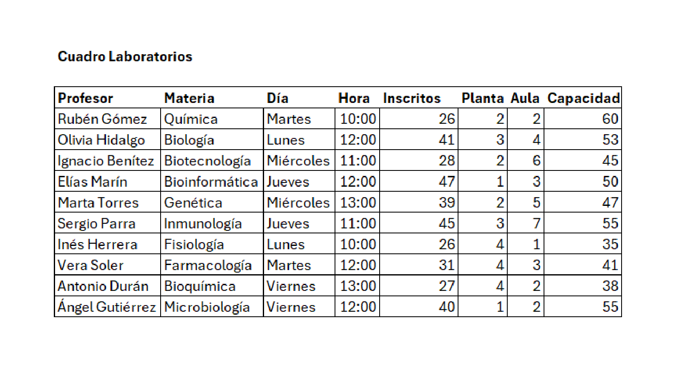

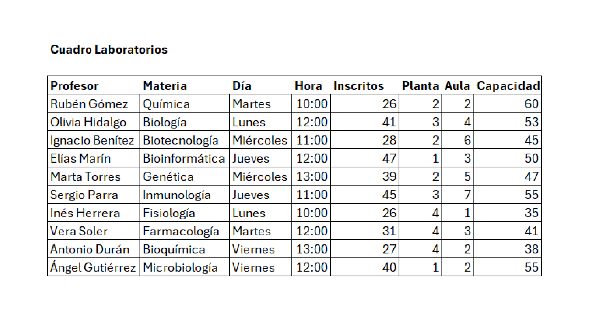

### contexts/2025I0A_p3.png ↔ contexts/2025I0B_p3.png

- El texto del título del ejemplo (la palabra Luxación) se distancia del siguiente párrafo más que los otros párrafos entre sí. ¿Cuál de las siguientes opciones, aplicada al título, permite lograr este formato?
- El texto que comienza por “La recuperación de lesiones …”, está enmarcado en el ejemplo. ¿Cuál de las siguientes opciones se habrá empleado para insertar el texto de esta forma?
- Sobre la “E” inicial del párrafo “Es posible que…” mostrado en la imagen del ejemplo se ha aplicado un formato. ¿Cuál de las siguientes opciones se corresponde con el nombre de este elemento decorativo?
- ¿Con cuál de las siguientes opciones se habrá insertado la flecha del comienzo del texto que se muestra en el ejemplo?
- ¿En cuál de las siguientes palabras del texto se ha creado un hipervínculo utilizando el formato por defecto?

### contexts/2025I0A_p4.png ↔ contexts/2025I0B_p6.png

- Los valores de la columna Demora en días tienen un formato personalizado. ¿De cuál de los siguientes se trata?
- Responda la siguiente pregunta según la imagen. ¿Cuál de los siguientes cálculos se habrá empleado en la celda F6?
- ¿Cuál de las siguientes funciones se ha utilizado en la celda F2 que se muestra en la imagen?
- ¿Desde qué grupo de comandos de la pestaña Inicio de la cinta de opciones podría convertirse en tabla el rango de celdas A1:F6, contenido en la imagen mostrada?
- ¿Qué función de las siguientes se ha empleado en la celda A6?

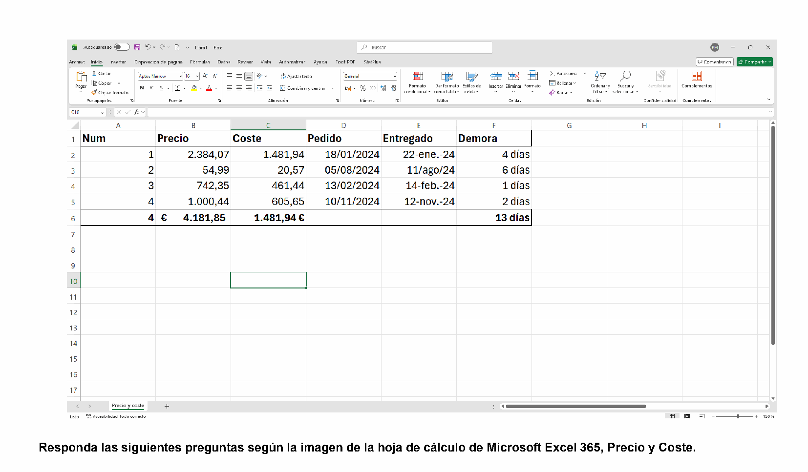

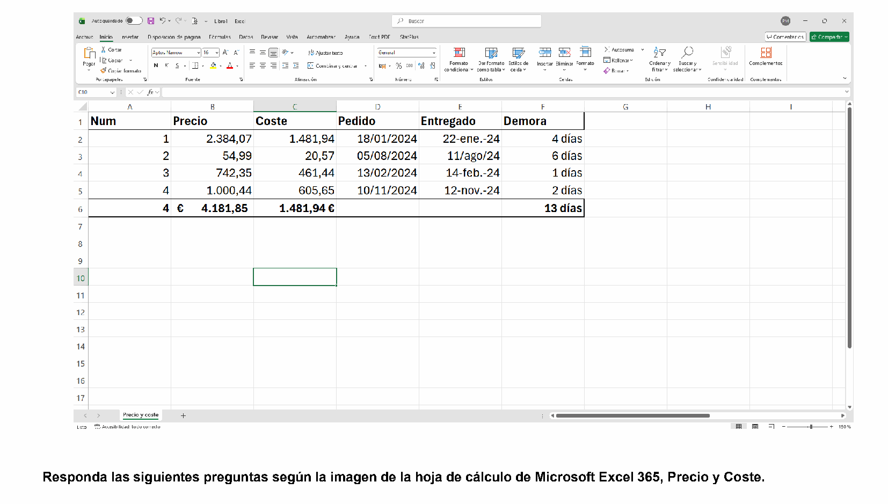

### contexts/2025I0A_p5.png ↔ contexts/2025I0B_p5.png

- Según la expresión introducida en las propiedades del campo Soporte, ¿cuál de las siguientes opciones describe correctamente su comportamiento?
- Teniendo en cuenta el formato aplicado al campo Soporte, ¿qué característica presentará su texto al ser visualizado?
- ¿Cuál es la longitud máxima de un campo de tipo Texto corto?
- ¿De cuál de los siguientes Tipos de datos de campo se muestran sus propiedades?
- ¿Qué Tipo de dato se ha utilizado para configurar el campo Empresa?

### contexts/2025I0A_p6.png ↔ contexts/2025I0B_p4.png

- Para trasladar el elemento actual a una carpeta diferente, según la imagen superior, ¿cuál de las siguientes pestañas se debe seleccionar?
- Una vez guardado el elemento o contacto, queremos contraer la cinta de opciones empleando el teclado. ¿Qué combinación de teclas emplearemos para ejecutar dicha acción?
- Una vez guardado el elemento, ¿desde qué pestaña de la cinta de opciones podemos crear un mensaje de correo electrónico dirigido a este contacto?
- ¿Desde qué pestaña de la cinta de opciones podemos editar la información secundaria del contacto Manuel Sánchez Sánchez como, por ejemplo, la fecha de su cumpleaños o el sobrenombre?
- ¿En qué apartado del panel de navegación nos encontramos actualmente?

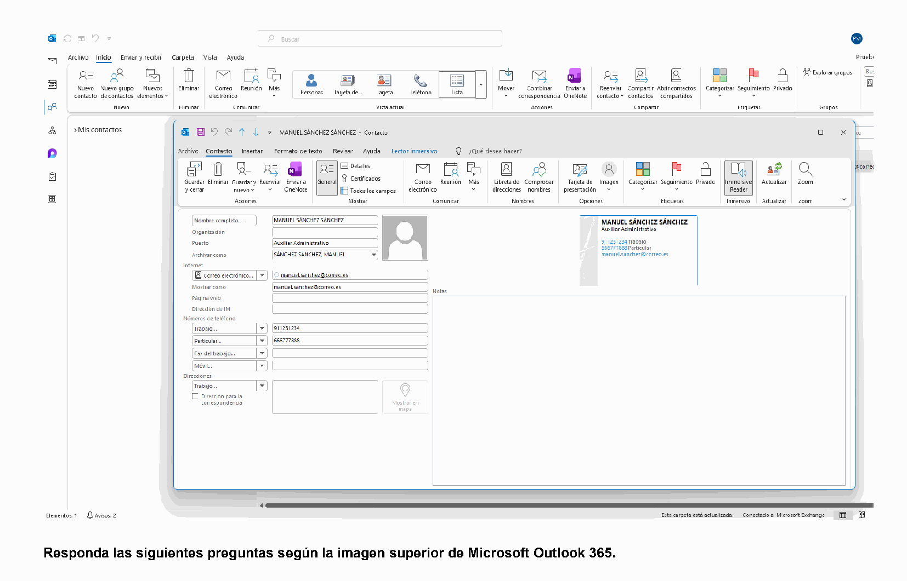

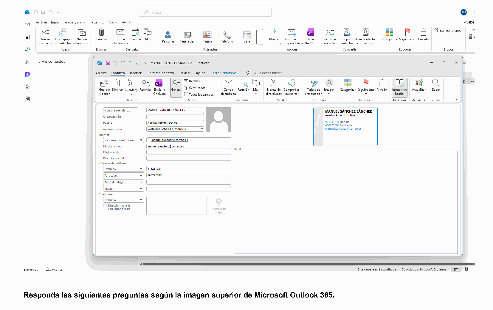

### contexts/2025L0A_p6.png ↔ contexts/2025L0B_p6.png

- ¿Cuál de las siguientes editoriales acumula un mayor número de ejemplares disponibles?
- ¿Cuál de las siguientes editoriales acumula un mayor número de ejemplares prestados?
- ¿Cuál de las siguientes editoriales acumula un mayor número de préstamos realizados?
- ¿Cuál de los siguientes autores tiene un mayor porcentaje de ejemplares prestados con respecto al total de préstamos realizados?
- ¿Cuál de los siguientes títulos está publicado en una editorial de Barcelona, en un año posterior a 1998 y cuenta con más de 10 ejemplares disponibles?
- ¿Cuál de los siguientes títulos tiene un mayor porcentaje de ejemplares prestados con respecto a los disponibles?

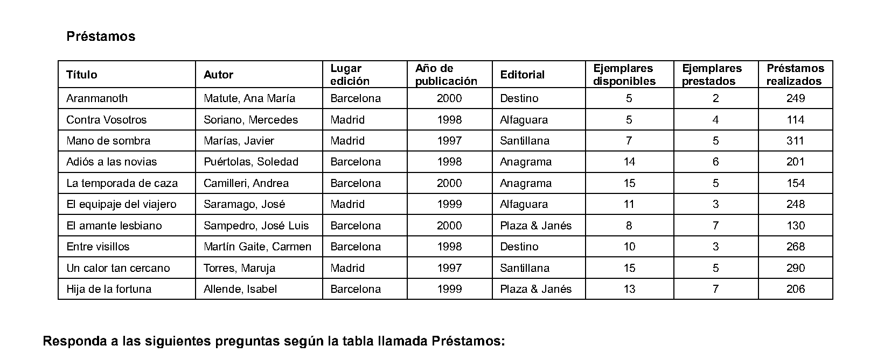

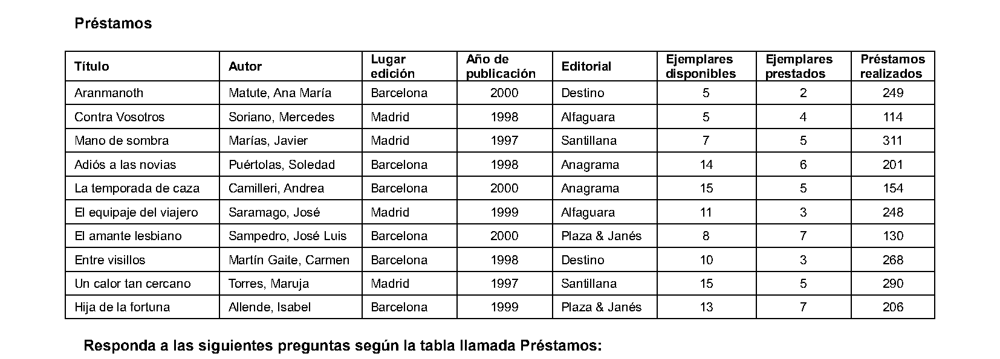

### contexts/2025L0A_p7.png ↔ contexts/2025L0B_p7.png

- ¿Cuál de las siguientes oficinas ha realizado un mayor número de kilómetros?
- ¿Cuál de los siguientes departamentos tiene una media mayor de duración en días de sus desplazamientos?
- ¿Cuál de los siguientes departamentos tiene una media mayor de pago en euros por peaje?
- ¿Cuál de los siguientes es el porcentaje de kilómetros realizados en el proyecto A-115 con respecto al total de kilómetros de todos los proyectos?
- ¿Cuál de los siguientes proyectos ha tenido un mayor pago de peajes por kilómetro realizado?
- ¿Cuál es el porcentaje de kilómetros realizados por la oficina de Tarragona con respecto al total de kilómetros realizado por todas las oficinas?

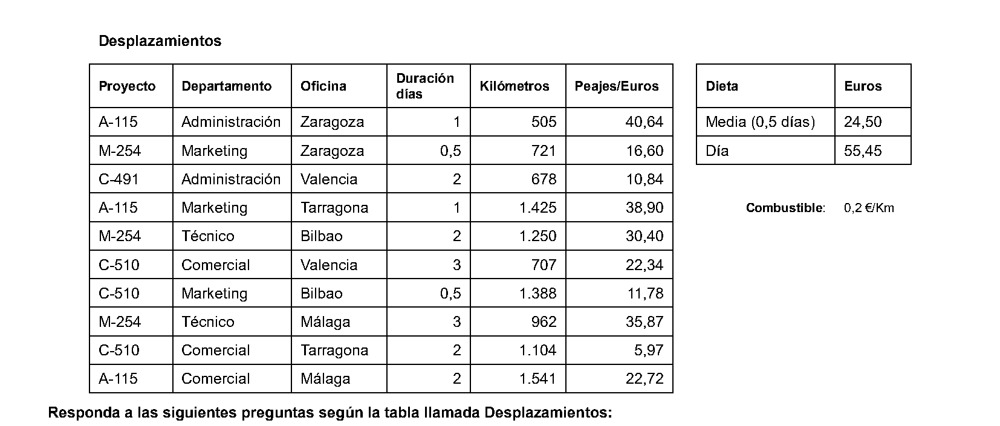

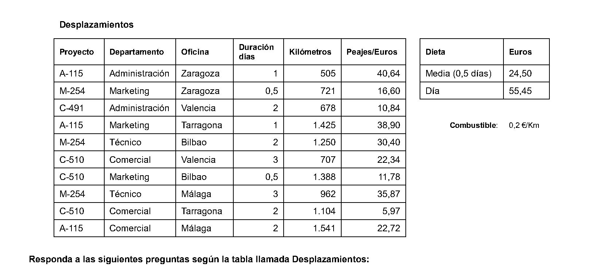
