# Contexts of duplicate questions — C2_AGE

Generated by `opox extract duplicates`; do not edit. 15 pair(s) of context
crops found together in a group of duplicate questions.

Fill in `same` in `dup_contexts.csv`: `y` if both crops are the same
context, `n` otherwise. Mandatory. A pair marked `n` splits every group listed;
questions without context stay with the most recent context.

## Line 2 — `contexts/2019E0A_p5.png` ↔ `contexts/2019L0A_p5.png`

- `2019E0A-1-35`, `2019L0A-1-31`: ¿Cuántas salas disponen de proyector, tienen decoración estándar y cuentan con toma de red?
- `2019E0A-1-36`, `2019L0A-1-32`: ¿Cuál de estas salas está disponible por las mañanas, con capacidad para más de 15 personas y tiene equipos informáticos suficientes para la capacidad máxima de alumnos de la sala?
- `2019E0A-1-37`, `2019L0A-1-33`: ¿Cuántos metros cuadrados en total hay disponibles en salas con proyector y decoración tipo ejecutiva por las tardes?
- `2019E0A-1-38`, `2019L0A-1-34`: De las salas de clases que cuentan con proyector y disponibilidad por las mañanas, ¿cuál tiene mayor capacidad de alumnos?
- `2019E0A-1-39`, `2019L0A-1-35`: ¿Qué media de capacidad de alumnos tienen las salas que cuentan con proyector y toma de red y tienen decoración tipo ejecutiva?
- `2019E0A-1-40`, `2019L0A-1-36`: ¿Cuál es la sala de reuniones, que no cuenta con toma de red, tiene disponibilidad por las mañanas y decoración tipo estándar?

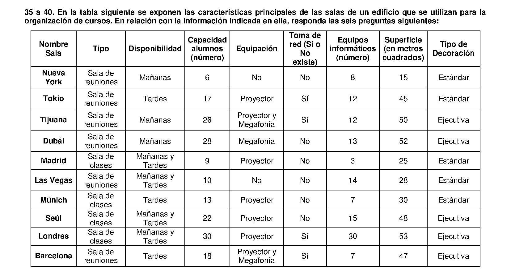 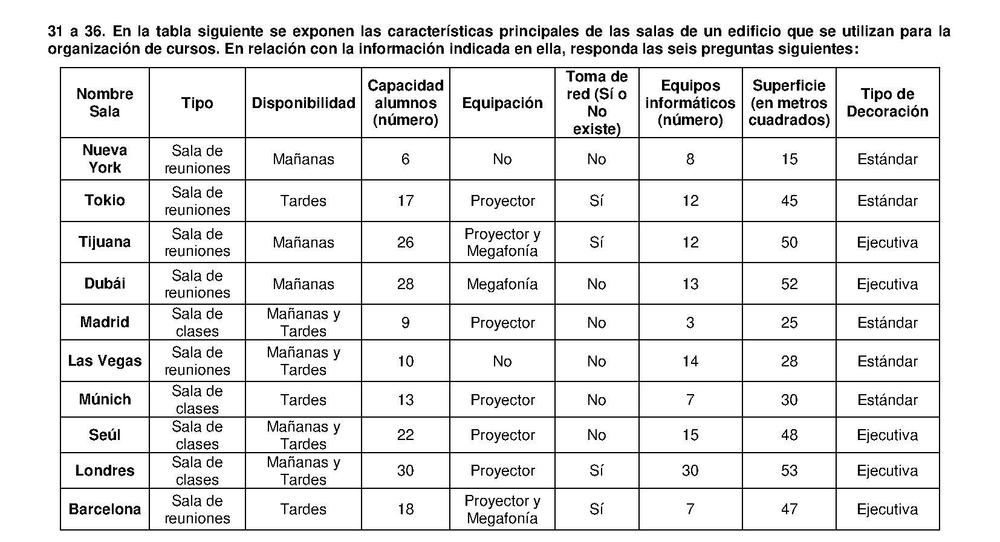

## Line 3 — `contexts/2019E0X_p4.png` ↔ `contexts/2019L0X_p6.png`

- `2019E0X-1-22`, `2019L0X-1-46`: ¿Cuántos títulos de materia Diccionario tienen la revisión terminada?
- `2019E0X-1-23`, `2019L0X-1-47`: ¿Cuántos títulos publicados por primera vez en el siglo XVIII cuentan con imágenes y su forma es facsímil?
- `2019E0X-1-24`, `2019L0X-1-48`: ¿Cuál es la fecha de la primera publicación de un facsímil con imágenes, la revisión terminada y cuya materia es Retórica y Poética?
- `2019E0X-1-25`, `2019L0X-1-49`: ¿Cuál es la fecha de la primera publicación de un diccionario, cuya forma no es Libro, cuya calidad original es media y cuya digitalización está en proceso?
- `2019E0X-1-26`, `2019L0X-1-50`: ¿Cuál de los siguientes títulos tiene forma facsímil, su calidad original es media y cuya digitalización está terminada?
- `2019E0X-1-27`, `2019L0X-1-51`: ¿Cuál es la forma del título que tiene la primera fecha de publicación en el siglo XIX, que es un diccionario y no tiene imágenes?

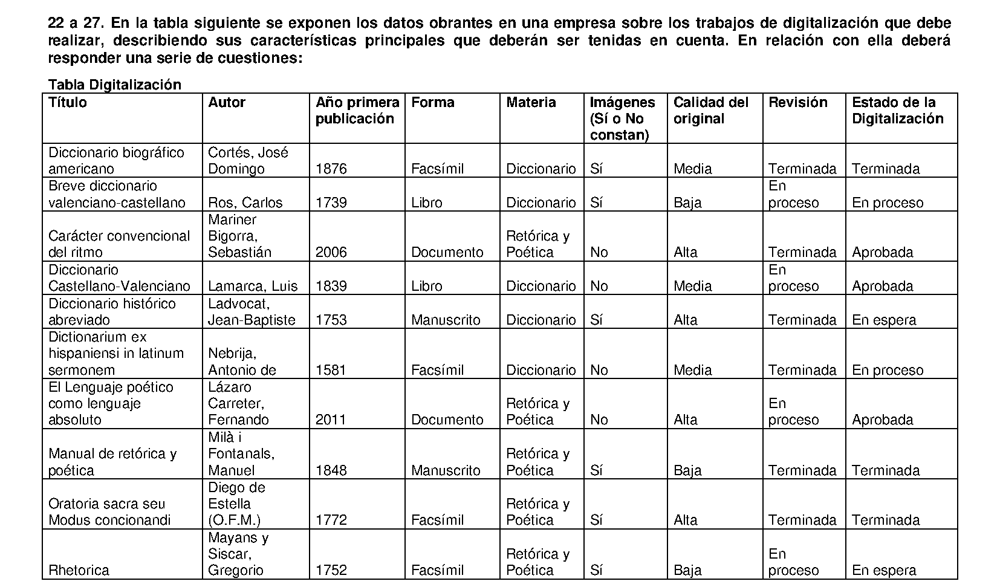 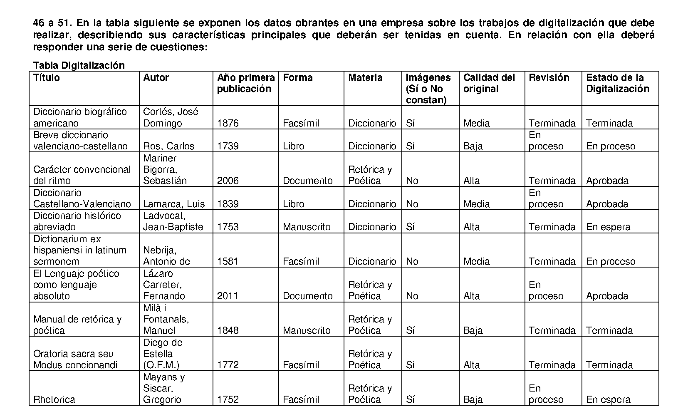

## Line 4 — `contexts/2022E0A_p4.png` ↔ `contexts/2022L0A_p6.png`

- `2022E0A-1-34`, `2022L0A-1-49`: Según los datos anteriores de la tabla Ponencias, ¿cuántos alumnos hay para cada ponente en la ponencia comercial del segundo turno de tarde?
- `2022E0A-1-35`, `2022L0A-1-50`: Según los datos anteriores de la Tabla Ponencias, ¿cuántos ponentes del segundo turno en mañana y tarde donde el tema fue "Recursos humanos" tienen de material un Cd?
- `2022E0A-1-36`, `2022L0A-1-51`: Según los datos anteriores de la Tabla Ponencias, ¿cuántos asistentes hay que requieren con material Pdf los turnos de tarde en la sala 1?
- `2022E0A-1-37`, `2022L0A-1-52`: Según los datos anteriores de la Tabla Ponencias, ¿cuál es el mínimo de asistentes por la tarde en ponencias de tipo charla?
- `2022E0A-1-38`, `2022L0A-1-53`: Según los datos anteriores de la Tabla Ponencias, ¿cuál es el total de asistentes en el segundo turno de mañana o tarde en una ponencia de tipo Laboratorio donde el tema no fue Recursos Humanos?
- `2022E0A-1-39`, `2022L0A-1-54`: Según los datos anteriores de la Tabla Ponencias, ¿cuántos asistentes acuden en la tarde en la sala 1?

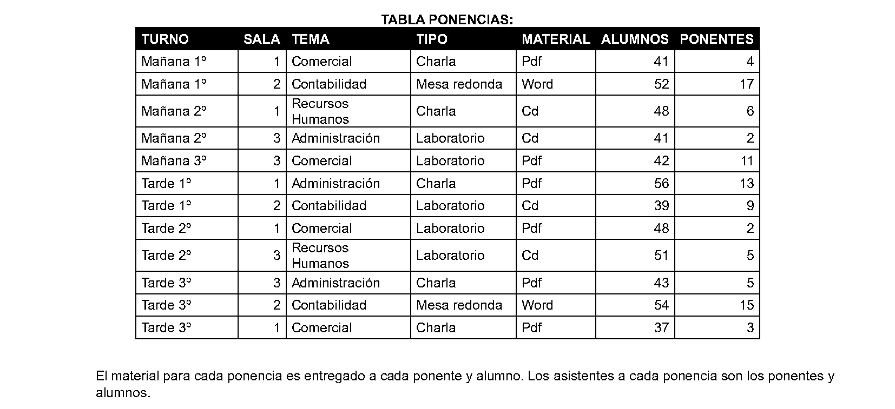 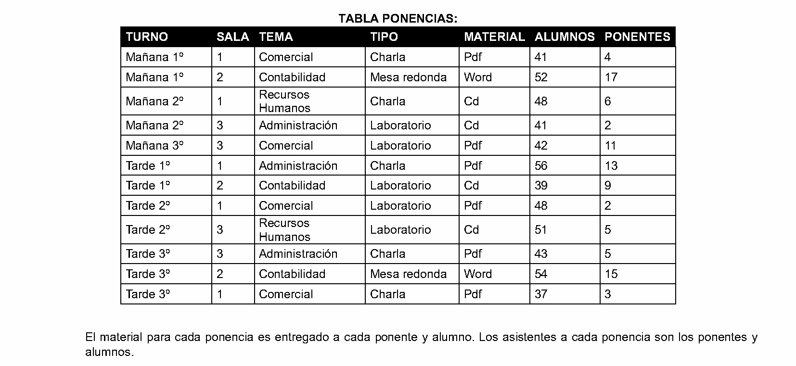

## Line 5 — `contexts/2024I0A_p3.png` ↔ `contexts/2024I0B_p3.png`

- `2024I0A-1-21`, `2024I0B-1-21`: ¿Cuál de los siguientes textos tiene la apariencia que Word da por defecto a un hipervínculo?
- `2024I0A-1-22`, `2024I0B-1-22`: Si el texto “Información sobre Sepúlveda” se repite en todas las páginas, ¿en cuál de las siguientes ubicaciones se encuentra?
- `2024I0A-1-23`, `2024I0B-1-24`: ¿Qué formato de los siguientes se ha aplicado al segundo párrafo del texto?
- `2024I0A-1-24`, `2024I0B-1-23`: Para no repetir a menudo la palabra “población” queremos sustituirla por otra de igual significado o muy parecido. ¿Qué herramienta de Word nos ayuda en este caso?
- `2024I0A-1-25`, `2024I0B-1-25`: ¿Qué nombre, de entre los propuestos, recibe el formato de fuente aplicado al texto HOCES DEL RÍO DURATÓN?

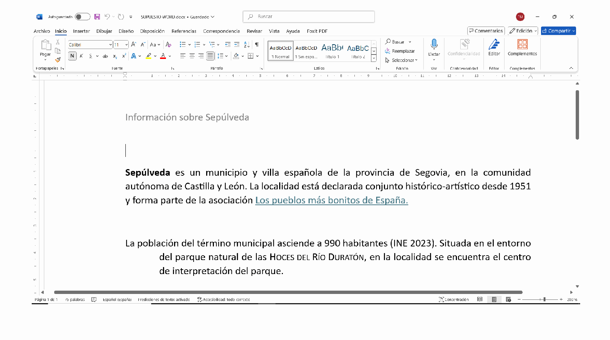 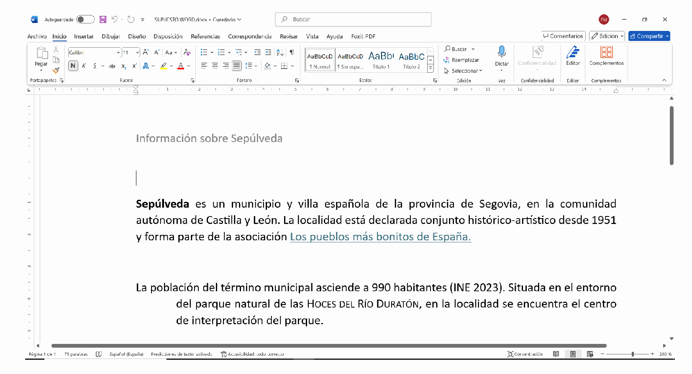

## Line 6 — `contexts/2024I0A_p4.png` ↔ `contexts/2024I0B_p4.png`

- `2024I0A-1-26`, `2024I0B-1-26`: ¿En qué celda de la imagen de Excel llamada Pedidos está situado el cursor actualmente?
- `2024I0A-1-27`, `2024I0B-1-27`: Indique cuál de los siguientes formatos se ha aplicado desde la opción “Bordes” al conjunto de las celdas que contienen los nombres de las columnas en la imagen de Excel llamada Pedidos.
- `2024I0A-1-28`, `2024I0B-1-29`: Indique cuál de las siguientes fórmulas es la aplicada en la celda H3.
- `2024I0A-1-29`, `2024I0B-1-28`: ¿Cuál de las siguientes fórmulas es la aplicada en la celda F8?
- `2024I0A-1-30`, `2024I0B-1-30`: Cuál de los siguientes es el tipo de dato y qué personalizaciones se le han aplicado en el formato en la celda I3.

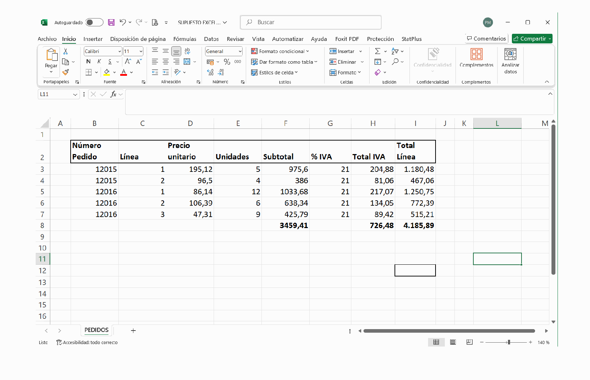 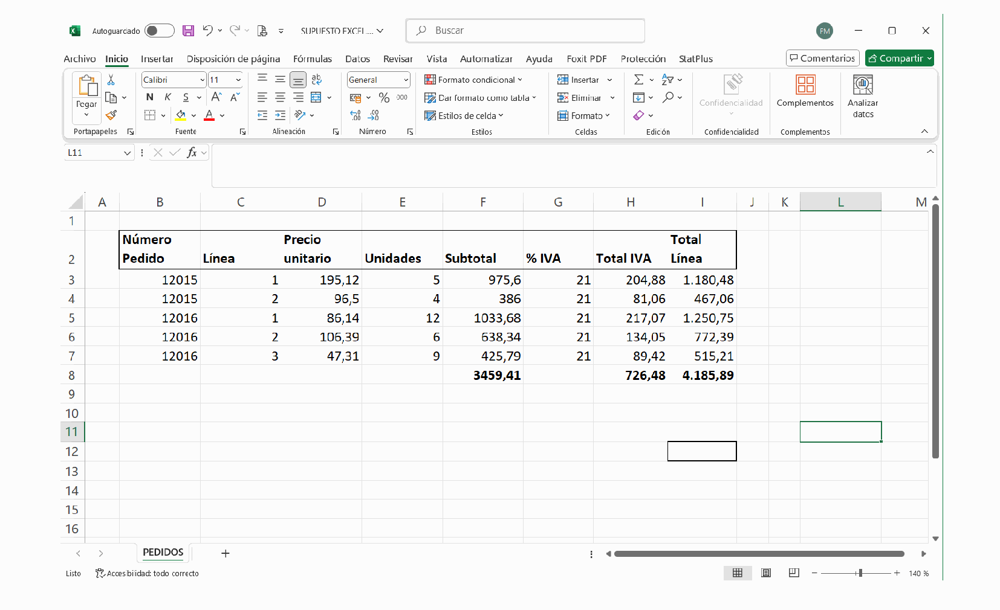

## Line 7 — `contexts/2024I0A_p5.png` ↔ `contexts/2024I0B_p5.png`

- `2024I0A-1-31`, `2024I0B-1-31`: Según el informe mostrado en la imagen de Access 365, confeccionada con el Asistente para informes, ¿en cuál de las siguientes secciones se muestra el nombre de la tabla o consulta que utiliza el informe como origen de datos?
- `2024I0A-1-32`, `2024I0B-1-32`: ¿Cuál de las siguientes opciones es correcta con respecto a la forma en que se mostrará en la vista preliminar del informe la expresión: =Ahora(), suponiendo que se le está aplicando el formato Fecha larga al campo correspondiente?
- `2024I0A-1-33`, `2024I0B-1-33`: Indique cuál de las siguientes opciones es correcta con respecto a la forma en que se mostrará en la vista preliminar del informe la expresión: ="Página " & \[Page\] & " de " & \[Pages\]
- `2024I0A-1-34`, `2024I0B-1-35`: De las siguientes opciones propuestas, ¿cuál es correcta con respecto a la forma en que se mostrará en la vista preliminar el informe?
- `2024I0A-1-35`, `2024I0B-1-34`: ¿Cuál de las siguientes opciones es correcta con respecto a la forma en que se mostrará el texto “Informe Clientes”?

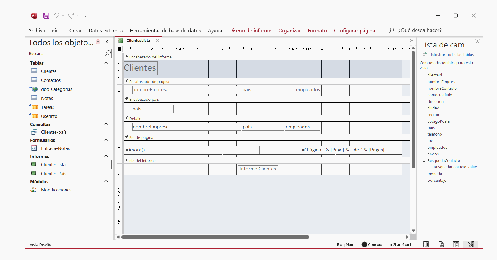 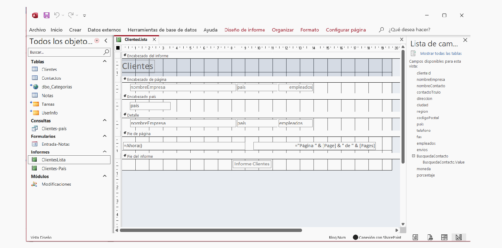

## Line 8 — `contexts/2024I0A_p6.png` ↔ `contexts/2024I0B_p6.png`

- `2024I0A-1-36`, `2024I0B-1-37`: Según la imagen de Outlook 365, ¿en qué lugar o a través de qué medio está previsto que se celebren las reuniones?
- `2024I0A-1-37`, `2024I0B-1-36`: Según la imagen de Outlook 365, queremos programar varias reuniones, la primera el día 5 de diciembre de 2024, con los asistentes que figuran como destinatarios. ¿Cuántas reuniones más, además de la del día 5 de diciembre, estamos programando?
- `2024I0A-1-39`, `2024I0B-1-40`: Una vez enviada la convocatoria de reuniones nos encontramos en la pantalla “Calendario”, ¿qué combinación de teclas emplearemos para ir a la pantalla “Correo” directamente?
- `2024I0A-1-40`, `2024I0B-1-39`: Una de las personas que asiste a las reuniones tiene problemas de visión, ¿qué herramienta aparece en la imagen con la que podrá escuchar en voz alta el texto del correo con la convocatoria?

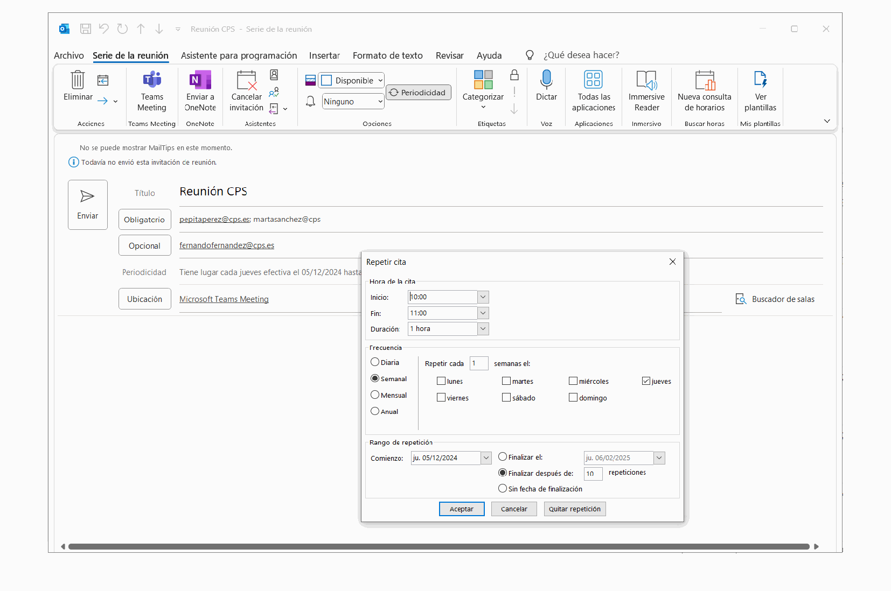 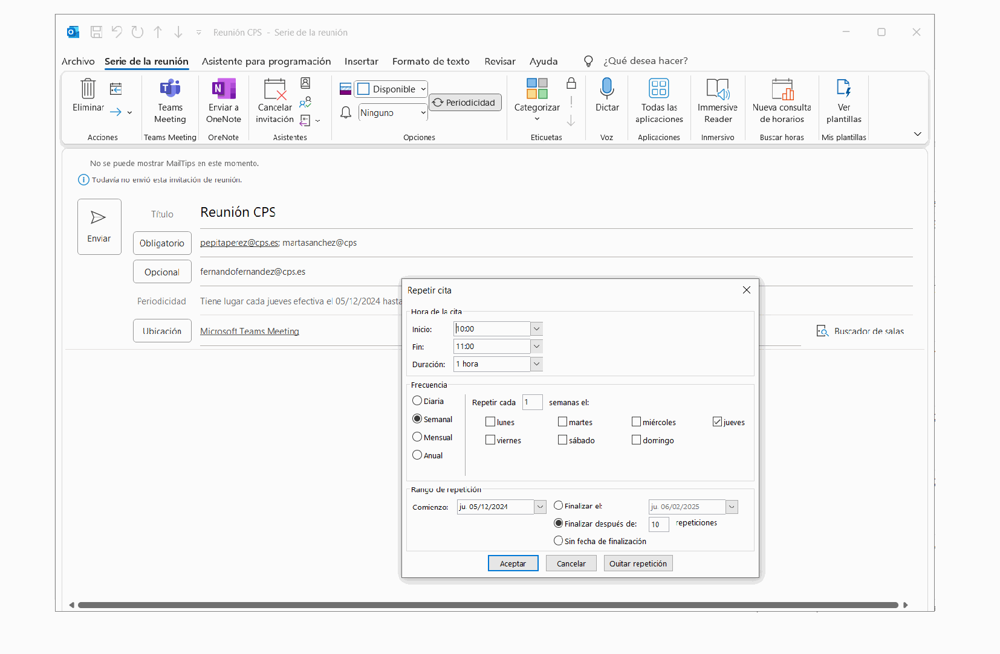

## Line 9 — `contexts/2024L0A_p6.png` ↔ `contexts/2024L0B_p6.png`

- `2024L0A-1-49`, `2024L0B-1-49`: Según los datos del cuadro Biblioteca, siendo que la columna Clasificación de ubicación se refiere al nombre del título, ¿en cuál de las siguientes ubicaciones, habría que colocar este libro? Tema: Derecho Económico. Nombre: "Trabajo temporal. Tributación".
- `2024L0A-1-50`, `2024L0B-1-50`: Según los datos del cuadro Biblioteca, siendo que la columna Clasificación de ubicación se refiere al nombre del título, ¿cuál de los siguientes títulos se ubicará en la planta 3, pasillo 1 izquierda, estanterías 1 a 4?
- `2024L0A-1-51`, `2024L0B-1-51`: Según los datos del cuadro Biblioteca, cuál de los siguientes temas tiene un mayor número total de títulos?
- `2024L0A-1-52`, `2024L0B-1-53`: Según los datos del cuadro Biblioteca, ¿cuál de los siguientes temas tiene un número total de títulos superior a la media de títulos por tema?
- `2024L0A-1-53`, `2024L0B-1-52`: Según los datos del cuadro Biblioteca, siendo que la columna Clasificación de ubicación se refiere al nombre del título, ¿en cuál de las siguientes ubicaciones, habría que colocar este libro? Tema: Geografía física. Nombre: "Cordilleras asiáticas".
- `2024L0A-1-54`, `2024L0B-1-54`: Según los datos del cuadro Biblioteca, siendo que la columna Clasificación de ubicación se refiere al nombre del título, ¿cuál de los siguientes títulos se ubicará en la planta 2, pasillo 1 izquierda, estanterías 2 a 4?

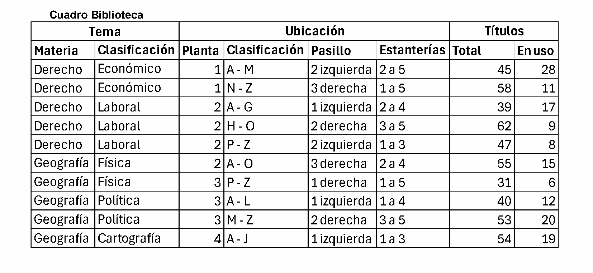 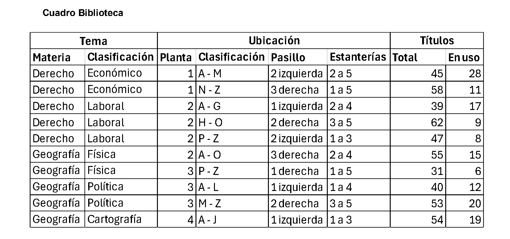

## Line 10 — `contexts/2024L0A_p7.png` ↔ `contexts/2024L0B_p7.png`

- `2024L0A-1-55`, `2024L0B-1-55`: Según los datos del cuadro Laboratorios y suponiendo que asisten todos los inscritos, ¿qué día hay mayor asistencia de alumnos?
- `2024L0A-1-56`, `2024L0B-1-58`: Según los datos del cuadro Laboratorios, ¿en cuál de las plantas hay una menor capacidad total?
- `2024L0A-1-57`, `2024L0B-1-56`: Según los datos del cuadro Laboratorios, ¿cuál de las siguientes aulas, situada por encima de la segunda planta, cuenta con un número mayor de inscritos?
- `2024L0A-1-58`, `2024L0B-1-60`: Según los datos del cuadro Laboratorios, indique cuál de las siguientes materias cuenta con un laboratorio de más de 45 puestos de capacidad, se imparte después del martes, y está en la planta 3.
- `2024L0A-1-59`, `2024L0B-1-57`: Según los datos del cuadro Laboratorios, ¿cuál de los siguientes profesores imparte su materia en la planta 2 y termina más tarde, teniendo en cuenta que todas las clases tienen una hora de duración?
- `2024L0A-1-60`, `2024L0B-1-59`: Según los datos del cuadro Laboratorios, indique cuál de los siguientes profesores imparte la materia en el aula número 2, con una capacidad superior a 40 puestos y a una hora más temprana.

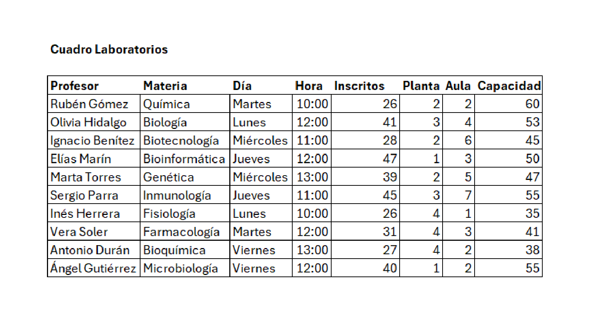 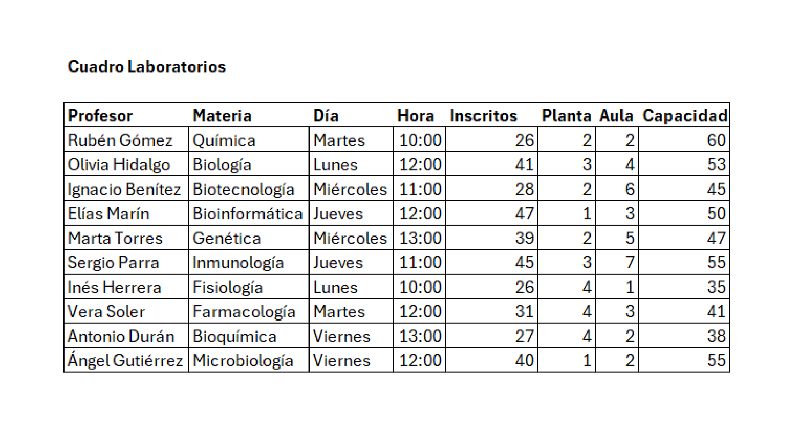

## Line 11 — `contexts/2025I0A_p3.png` ↔ `contexts/2025I0B_p3.png`

- `2025I0A-1-21`, `2025I0B-1-21`: ¿En cuál de las siguientes palabras del texto se ha creado un hipervínculo utilizando el formato por defecto?
- `2025I0A-1-22`, `2025I0B-1-22`: ¿Con cuál de las siguientes opciones se habrá insertado la flecha del comienzo del texto que se muestra en el ejemplo?
- `2025I0A-1-23`, `2025I0B-1-23`: El texto del título del ejemplo (la palabra Luxación) se distancia del siguiente párrafo más que los otros párrafos entre sí. ¿Cuál de las siguientes opciones, aplicada al título, permite lograr este formato?
- `2025I0A-1-24`, `2025I0B-1-24`: El texto que comienza por “La recuperación de lesiones …”, está enmarcado en el ejemplo. ¿Cuál de las siguientes opciones se habrá empleado para insertar el texto de esta forma?
- `2025I0A-1-25`, `2025I0B-1-25`: Sobre la “E” inicial del párrafo “Es posible que…” mostrado en la imagen del ejemplo se ha aplicado un formato. ¿Cuál de las siguientes opciones se corresponde con el nombre de este elemento decorativo?

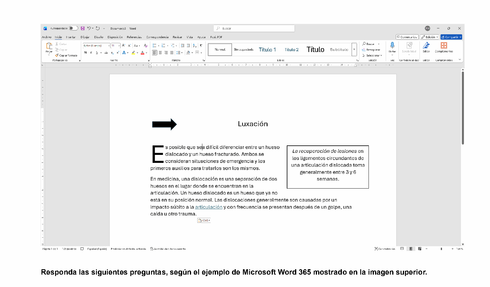 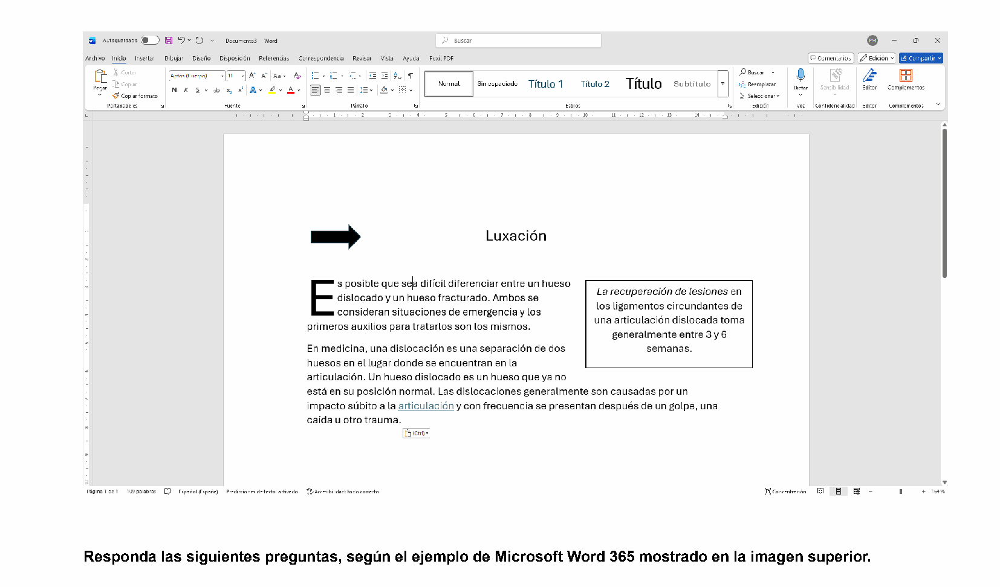

## Line 12 — `contexts/2025I0A_p4.png` ↔ `contexts/2025I0B_p6.png`

- `2025I0A-1-26`, `2025I0B-1-36`: ¿Qué función de las siguientes se ha empleado en la celda A6?
- `2025I0A-1-27`, `2025I0B-1-37`: Responda la siguiente pregunta según la imagen. ¿Cuál de los siguientes cálculos se habrá empleado en la celda F6?
- `2025I0A-1-28`, `2025I0B-1-38`: ¿Desde qué grupo de comandos de la pestaña Inicio de la cinta de opciones podría convertirse en tabla el rango de celdas A1:F6, contenido en la imagen mostrada?
- `2025I0A-1-29`, `2025I0B-1-39`: Los valores de la columna Demora en días tienen un formato personalizado. ¿De cuál de los siguientes se trata?
- `2025I0A-1-30`, `2025I0B-1-40`: ¿Cuál de las siguientes funciones se ha utilizado en la celda F2 que se muestra en la imagen?

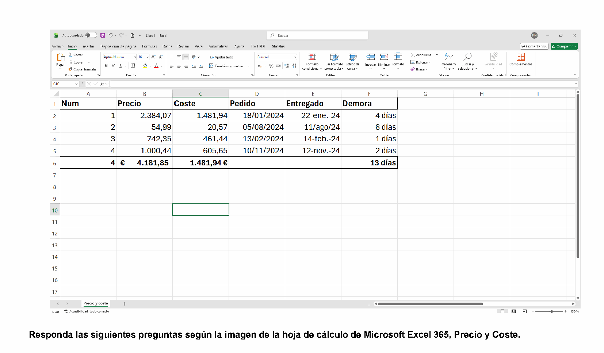 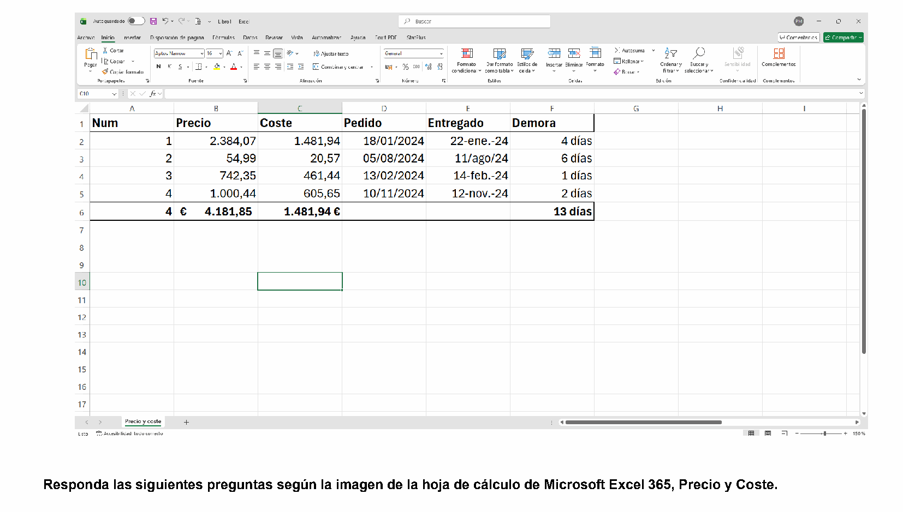

## Line 13 — `contexts/2025I0A_p5.png` ↔ `contexts/2025I0B_p5.png`

- `2025I0A-1-31`, `2025I0B-1-31`: ¿Cuál es la longitud máxima de un campo de tipo Texto corto?
- `2025I0A-1-32`, `2025I0B-1-32`: ¿De cuál de los siguientes Tipos de datos de campo se muestran sus propiedades?
- `2025I0A-1-33`, `2025I0B-1-33`: Teniendo en cuenta el formato aplicado al campo Soporte, ¿qué característica presentará su texto al ser visualizado?
- `2025I0A-1-34`, `2025I0B-1-34`: Según la expresión introducida en las propiedades del campo Soporte, ¿cuál de las siguientes opciones describe correctamente su comportamiento?
- `2025I0A-1-35`, `2025I0B-1-35`: ¿Qué Tipo de dato se ha utilizado para configurar el campo Empresa?

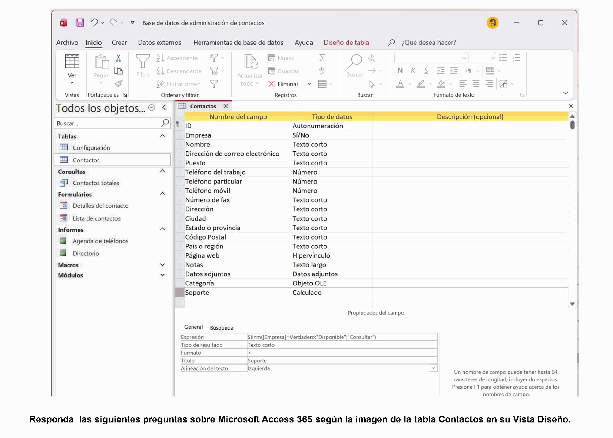 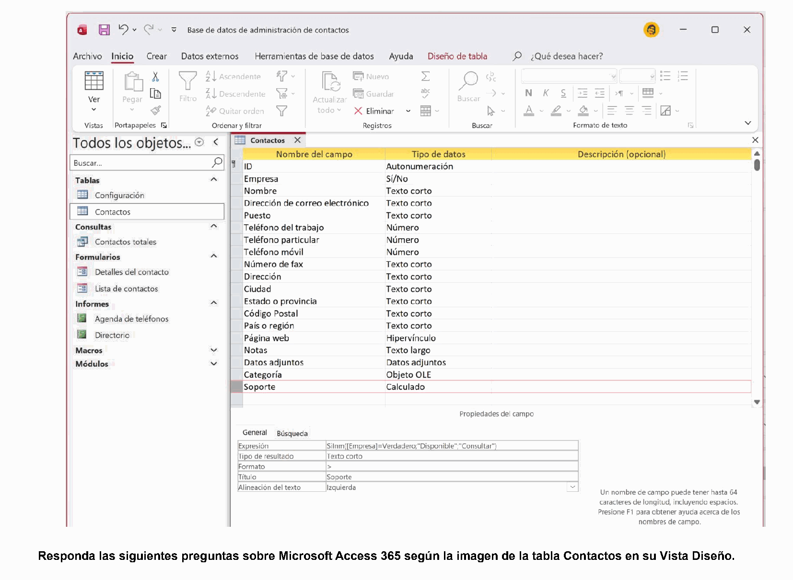

## Line 14 — `contexts/2025I0A_p6.png` ↔ `contexts/2025I0B_p4.png`

- `2025I0A-1-36`, `2025I0B-1-26`: ¿En qué apartado del panel de navegación nos encontramos actualmente?
- `2025I0A-1-37`, `2025I0B-1-27`: ¿Desde qué pestaña de la cinta de opciones podemos editar la información secundaria del contacto Manuel Sánchez Sánchez como, por ejemplo, la fecha de su cumpleaños o el sobrenombre?
- `2025I0A-1-38`, `2025I0B-1-28`: Una vez guardado el elemento, ¿desde qué pestaña de la cinta de opciones podemos crear un mensaje de correo electrónico dirigido a este contacto?
- `2025I0A-1-39`, `2025I0B-1-29`: Una vez guardado el elemento o contacto, queremos contraer la cinta de opciones empleando el teclado. ¿Qué combinación de teclas emplearemos para ejecutar dicha acción?
- `2025I0A-1-40`, `2025I0B-1-30`: Para trasladar el elemento actual a una carpeta diferente, según la imagen superior, ¿cuál de las siguientes pestañas se debe seleccionar?

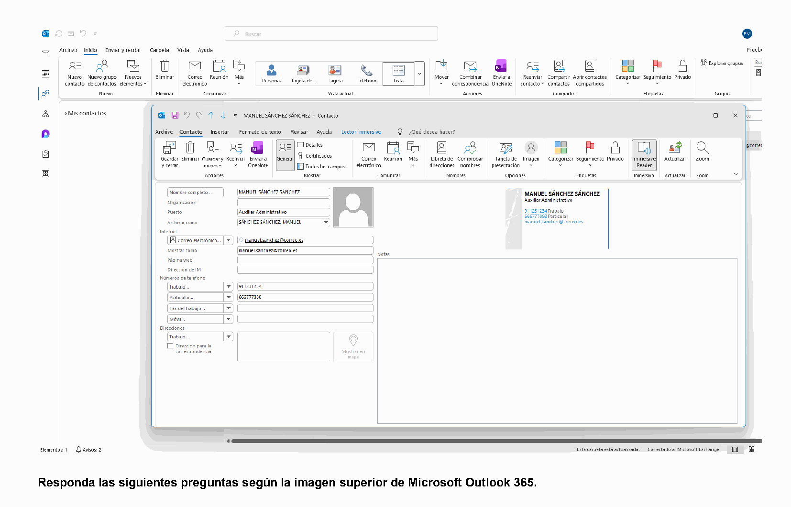 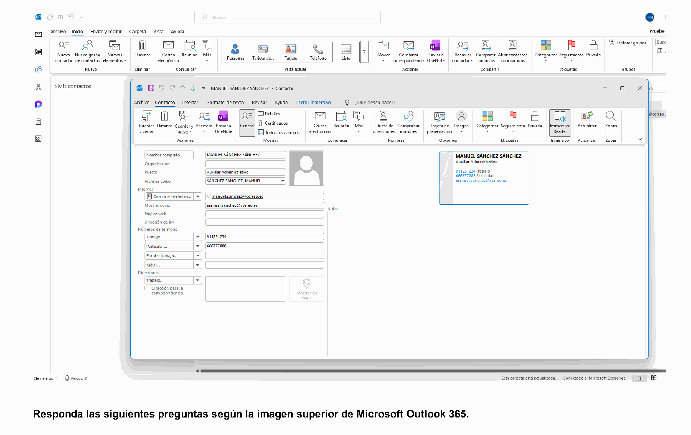

## Line 15 — `contexts/2025L0A_p6.png` ↔ `contexts/2025L0B_p6.png`

- `2025L0A-1-49`, `2025L0B-1-51`: ¿Cuál de las siguientes editoriales acumula un mayor número de ejemplares disponibles?
- `2025L0A-1-50`, `2025L0B-1-49`: ¿Cuál de las siguientes editoriales acumula un mayor número de préstamos realizados?
- `2025L0A-1-51`, `2025L0B-1-50`: ¿Cuál de los siguientes títulos está publicado en una editorial de Barcelona, en un año posterior a 1998 y cuenta con más de 10 ejemplares disponibles?
- `2025L0A-1-52`, `2025L0B-1-53`: ¿Cuál de las siguientes editoriales acumula un mayor número de ejemplares prestados?
- `2025L0A-1-53`, `2025L0B-1-52`: ¿Cuál de los siguientes títulos tiene un mayor porcentaje de ejemplares prestados con respecto a los disponibles?
- `2025L0A-1-54`, `2025L0B-1-54`: ¿Cuál de los siguientes autores tiene un mayor porcentaje de ejemplares prestados con respecto al total de préstamos realizados?

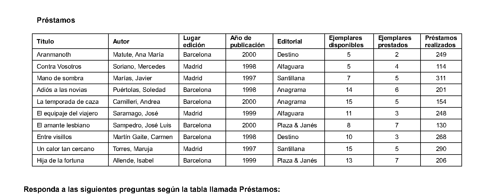 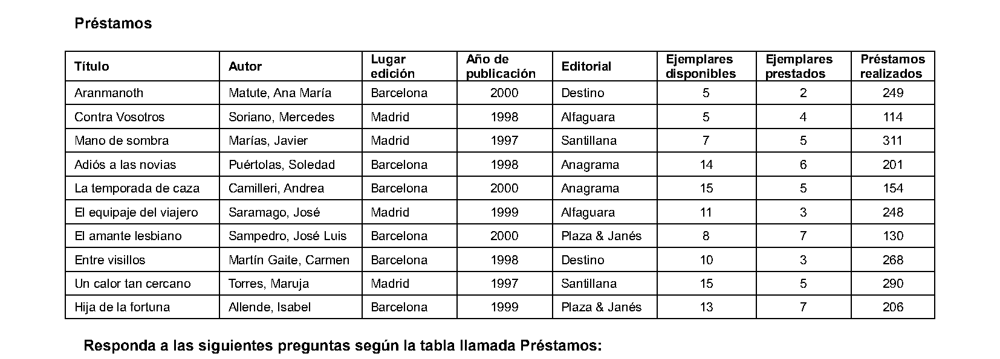

## Line 16 — `contexts/2025L0A_p7.png` ↔ `contexts/2025L0B_p7.png`

- `2025L0A-1-55`, `2025L0B-1-57`: ¿Cuál de las siguientes oficinas ha realizado un mayor número de kilómetros?
- `2025L0A-1-56`, `2025L0B-1-58`: ¿Cuál de los siguientes departamentos tiene una media mayor de duración en días de sus desplazamientos?
- `2025L0A-1-57`, `2025L0B-1-55`: ¿Cuál de los siguientes departamentos tiene una media mayor de pago en euros por peaje?
- `2025L0A-1-58`, `2025L0B-1-56`: ¿Cuál de los siguientes proyectos ha tenido un mayor pago de peajes por kilómetro realizado?
- `2025L0A-1-59`, `2025L0B-1-60`: ¿Cuál es el porcentaje de kilómetros realizados por la oficina de Tarragona con respecto al total de kilómetros realizado por todas las oficinas?
- `2025L0A-1-60`, `2025L0B-1-59`: ¿Cuál de los siguientes es el porcentaje de kilómetros realizados en el proyecto A-115 con respecto al total de kilómetros de todos los proyectos?

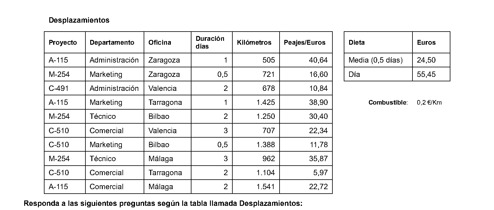 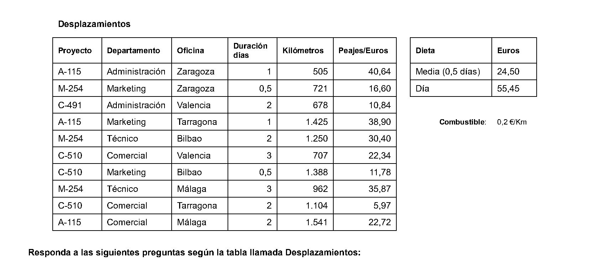
